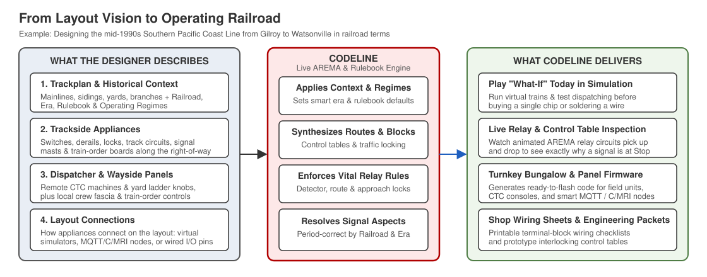
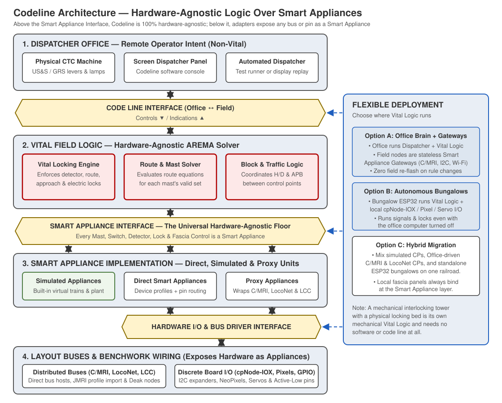

# Codeline

**Codeline** is a system for designing, simulating, and operating period-correct model railroads—bridging the gap between a prototype trackplan and live trackside hardware without hand-coding hundreds of brittle panel conditionals.

Model a subdivision using real railroad operating regimes (CTC, Rule 251, ABS/APB, Yard Limits, DTC/TWC), operate it immediately in simulation, and connect physical layout hardware incrementally across a clean, hardware-agnostic MQTT boundary.

---

## Three Actors, Two Clean Interfaces

Codeline splits layout design, vital railroad logic, and physical hardware into three distinct actors:

1. **[Studio](docs/Studio.md)** — *The workshop that helps you create, simulate, and wire your layout.*
   Sketch the trackplan, assign era-specific operating regimes and appliances, test meets in real time with animated AREMA relay diagrams, discover live hardware dynamically, import existing JMRI/CATS/C/MRI setups, and generate under-benchwork wiring templates, cable looms, and ready-to-flash microcontroller firmware.
2. **[Codeline](docs/Codeline.md)** — *The prototypical logic that operates your layout.*
   Connects dispatcher offices and local panels across the **Code Line Interface** to hardware-agnostic **Vital Field Logic** (detector, route, approach, time, and switch locking plus declarative route/signal resolution). Run the vital logic on an office computer, distributed in bungalow ESP32s under the layout, or in a hybrid mix.
3. **[Smart Appliances](docs/SmartAppliances.md)** — *The smart devices that bring your layout to life.*
   An open, controller-agnostic MQTT specification modeled on Zigbee/Matter capability clusters and AREMA functional interfaces. Every switch, sensor, signal mast, train-order board, grade crossing, control panel, or lamp speaks the same operational and maintenance API—whether simulated in software, running natively on a microcontroller, or proxied over existing `C/MRI`, `LocoNet`, or `LCC` hardware.

---

## Documentation Guide

| Document | Focus |
| :--- | :--- |
| **[Studio](docs/Studio.md)** | Trackplan authoring, live simulation, dynamic hardware discovery, pin bindings, legacy bus import, and benchwork wiring documentation |
| **[Codeline](docs/Codeline.md)** | Operating regimes, positive control & fail-safe design, Code Line Interface, declarative signal solver, deployment topologies, and standalone fallback |
| **[Smart Appliances](docs/SmartAppliances.md)** | Functional hardware model, two-plane/four-topic MQTT architecture, power-up safety, and the three interchangeable implementations |
| **[Walkthrough](docs/Walkthrough.md)** | End-to-end CP Corporal westbound move (dispatcher levers → vital logic → MQTT wire trace → APB tumble-down), offline servo calibration, and dynamic discovery |
| **[Background](docs/Background.md)** | Reference 1992–1996 Southern Pacific Coast Line setting (Gilroy–Watsonville), timetable conventions, rulebook & equipment eras, and US&S / AREMA nomenclature guide |
| **[Capability Clusters](docs/clusters/README.Clusters.md)** | Normative reference for all 14 general and railroad capability clusters (`MAINTENANCE`, `GROUPS`, `POSITION`, `TURNOUT`, `MAST`, `APB`, etc.) |
| **[Appliance Catalog](docs/appliances/README.Appliances.md)** | Normative catalog of all 7 Smart Appliances (`TURNOUT`, `SENSOR`, `SIGNALMAST`, `TRAINORDER`, `CROSSING`, `CONTROL`, `LAMP`) with startup states and `OFFLINE` maintenance mode |
