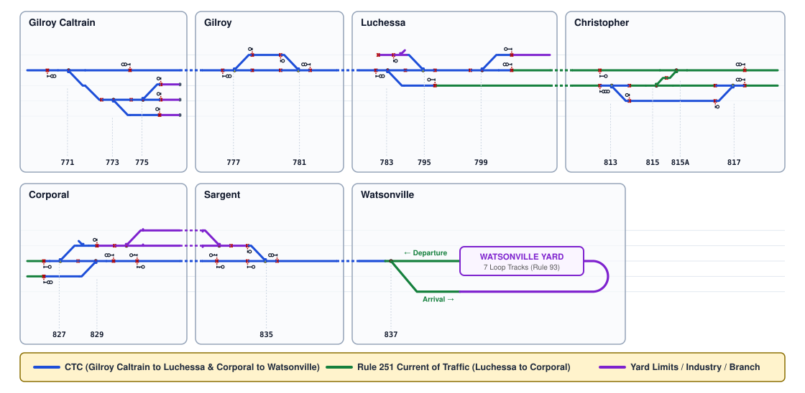

# Historical Context, Prototype Conventions, and Nomenclature

This companion reference provides the historical railroad background, era-specific signaling evolution, and prototype **US&S / AREMA** nomenclature behind [**Codeline**](Codeline.md) and the [**Walkthroughs**](Walkthrough.md).

---

## 1. The Reference Corridor: Southern Pacific Coast Line (1992–1996)

Our reference layout models Southern Pacific's Coast Line between **Gilroy** and **Watsonville** at the south end of the San Jose–Watsonville commute and freight corridor, using selective compression while staying faithful to Southern Pacific operating rules and signaling practice:

Seven representative locations anchor the subdivision: **Gilroy** (Caltrain commuter terminal and local industry), **Carnadero** (junction for the Hollister branch line), **Luchessa** and **Christopher** (directional double track with a power crossover), **CP Corporal** (end of double track and the beet loader siding), **CP Sargent** (passing siding), and **Watsonville** (staging yard and yard-limit territory).

Two prototype milestones define the **1992–1996** modeling window and its operating mix:

- **Mixed Control Regimes**: Prototype railroads installed Centralized Traffic Control (CTC) only where traffic justified the capital expense. On the Coast Line, **CP Corporal to CP Logan** was converted from ABS to CTC in **1959**; **San Jose (CP Lick) to Gilroy** was upgraded from DTC/ABS to full CTC in **July 1992** when the Peninsula Corridor Joint Powers Board extended Caltrain commuter service to Gilroy. Much of the remaining mainline and branch trackage operated as CTC islands linked by **Direct Traffic Control (DTC)**—and later **Track Warrant Control (TWC)**—overlaying Automatic Block Signals (ABS).
- **Rulebook & Era Boundaries**: Southern Pacific replaced its Standard Code–derived Book of Rules with the **General Code of Operating Rules (GCOR)** in **1985**. Caltrain's arrival in **July 1992** sets the earliest date, and the **Union Pacific merger in 1996** closes the Espee era.

---

## 2. Timetable Orientation and Plant Naming Conventions

Codeline follows Southern Pacific timetable and US&S interlocking conventions consistently across trackplans and code lines:

- **Westward (`W`) vs. Eastward (`E`) Parity**: On the Southern Pacific, movements *toward San Francisco* were designated **Westward (`W`)** and carried **odd** numbers, while movements *away from San Francisco* (toward San Jose, Gilroy, and Los Angeles) were designated **Eastward (`E`)** and carried **even** numbers—even where the Coast Line runs compass north and south. *(When Caltrain later adopted **Northward / Southward** compass directions on the Peninsula, it kept SP's odd/even parity: Northward toward San Francisco stayed odd and Southward stayed even, inverting the usual North American odd = South/West convention.)* Because our corridor models the Southern Pacific, we use SP's **`W` / `E`** convention throughout.
- **Interlocking Switches and Signals**: Inside a control point, switches take **odd** numbers and signal groups take **even** numbers keyed to the station's milepost from San Francisco. At **CP Corporal (MP 83.0)**, Switches `827` and `829` pair with Signal groups `828` and `830`.
- **Signal Mast Identifiers**: Controlled masts combine the signal group number, timetable direction (`W` or `E`), and head letters from top to bottom—so **`830WAB`** is Signal `830`, Westward, with upper head `A` and lower head `B`. Automatic block signals between control points carry odd numbers Westward (`831WA`, `833WA`) and even numbers Eastward (`832EA`, `834EA`).
- **Track Circuits**: Track detector sections end in **`T`**: mainline blocks (`832T`), sidings (`01T`), and over-switch (`OS`) sections protecting individual switches (`827T1`, `829T1`).

---

## 3. Rulebooks and Signaling Equipment by Era

Selecting an era in [**Studio**](Studio.md) governs both the operating rulebook and the physical aspects displayed by trackside signal masts:

### Operating Rulebooks
- **Early Fragmentation (1830s–1880s)**: Railroads published their own operating rules as pamphlets or on the reverse of employee timetables.
- **The Standard Code (1887–1889)**: Following Standard Time (1883), the General Time Convention established the Standard Code of Operating Rules as a shared template for terminology, rule numbering, and train-order operation.
- **Regional Codes & SP Rules (Mid-20th Century)**: While many railroads joined the Consolidated (`CCOR`) or Uniform (`UCOR`) codes, Southern Pacific published its own independent Books of Rules (notably the 1951 and 1969 editions) tailored to its timetable, train-order, Rule 251, and CTC operations.
- **GCOR (1985–present)**: Following Staggers Act deregulation and western mergers, Southern Pacific adopted the **General Code of Operating Rules (GCOR)** in 1985—the rulebook active during our 1992–1996 window.

### Wayside Signaling Equipment
- **Turn of the 20th Century (1898–1908)**: SP installed its first ABS signals in 1901 between San Francisco and San Bruno using Union Switch & Signal **Style B two-position lower-quadrant semaphores** (horizontal = `STOP`, dropped 60° = `CLEAR`; displaying `APPROACH` required a two-blade home-and-distant mast). Early night roundels used White = `CLEAR`, Green = `CAUTION`, and Red = `STOP`.
- **Early Steam Era (Post-1908)**: Three-position **upper-quadrant semaphores** added a 45° `APPROACH` position on one blade, enabling route signaling on a two-head mast. Night colors shifted to Green = `CLEAR`, Yellow = `APPROACH`, and Red (or an unexpected white light from a broken roundel) = `STOP`.
- **Mid-Century Searchlight Era (1930s–1960s)**: After US&S introduced the **H-2 searchlight** in 1928, SP deployed searchlights across the Central Valley and onto the Coast Division by 1940 while keeping semaphores on secondary lines into the 1980s. Combined with flasher relays, SP used **Flashing Red** through the 1950s and 1960s for `RESTRICTING`.
- **1970s to Mid-1990s**: Beginning in the late 1960s and accelerating through the 1980s–1990s, SP transitioned `RESTRICTING` and `APPROACH_RESTRICTING` from Flashing Red to **Lunar White**, and around 1990 began supplementing H-2 searchlights with modular multi-lamp color-light heads under GCOR.

---

## 4. US&S Code-Line and AREMA Vital Relay Guide

Prototype CTC code lines and relay bungalows use compact letter stacks read from **left to right**, where each modifier narrows a core function or relay role:

- **`N` / `R`** indicate **Normal** or **Reverse** position.
- **`W`** means **Switch** when following `N`/`R` (`NWS`, `NWK`, `WLR`), and **Westward** when prefixing a signal (`WGS`, `WGK`); **`E`** prefixes **Eastward** signals (`EGS`, `EGK`).
- **`G`** denotes a **Signal** function, **`H`** denotes **Home / Hold**, **`S`** marks a **Stick** relay or office-to-field control demand, **`K`** marks an **Indication** bit or correspondence relay, and **`R`** marks a physical vital **Relay**.

### Switch Control, Locking, and Correspondence
When the dispatcher lines a switch, the office transmits a positive-control demand—**`NWS`** (Normal Switch Stick) to request Normal or **`RWS`** (Reverse Switch Stick) to request Reverse. In the field bungalow, those demands cannot energize the switch operating relays (**`NWR`** / **`RWR`**) unless the master **Switch Lock Relay (`WLR`)** is picked—proving that the over-switch track circuit is vacant and no route, approach, or time lock holds the switch. Once the switch machine throws and mechanically locks its points, point contacts pick up the vital correspondence relay (**`NWKR`** / **`RWKR`** or repeater **`NWPR`** / **`RWPR`**), which sends **`NWK`** or **`RWK`** back over the code line to light the Normal or Reverse lamp on the CTC panel. While points are moving or out of correspondence, both `NWK` and `RWK` drop dark and no protecting signal can clear.

### Signal Clearing, Cancellation, and Time Locking
To clear a signal, the office transmits **`WGS`** (Westward Signal Stick) or **`EGS`** (Eastward Signal Stick). If locking checks pass, the vital **Home Relay (`HR`)** picks up to permit a basic proceed indication (`APPROACH`), and when the next signal ahead is proceed, the **Distant Relay (`DR`)** picks up to upgrade the mast to `CLEAR` and feed the distant circuit to the signal in rear. Once the mast displays a proceed aspect, its stop-proving correspondence relay (**`RGKR`**) drops and the field sends **`WGK`** or **`EGK`** back to the office.

If the dispatcher centers the signal lever to cancel a cleared route, the office sends **`HS`** (Hold Signal / Stop demand). Returning the signal to `STOP` while a train is on the approach drops the **Approach Stick Relay (`ASR` / `HSR`)**, which keeps `WLR` locked so switches cannot be thrown in front of an approaching train. Only after the mast physically confirms `STOP` (`RGKR` up) does the vital **Time Element Relay (`TER`)** begin its safety countdown—illuminating the office **Time-Locking Indication (`TEK`)** until the timer expires (or the train passes the `OS` section) and releases the lock.

### Track Circuits and Directional Memory
Every block and `OS` section is monitored by a gravity-drop **Track Relay (`TR`)**—specifically **`OSTR`** over a switch and **`ATR`** on an approach block—which de-energizes whenever a train shunts the rails (or power fails). To remember a train's direction of travel across single-track APB territory and interlockings, vital **Stick Relays (`SR`, `WSR`, `ESR`)** latch as consecutive `TR`s drop and pick up, holding opposing signals at `STOP` while releasing blocks behind a departing train so following moves can proceed.
