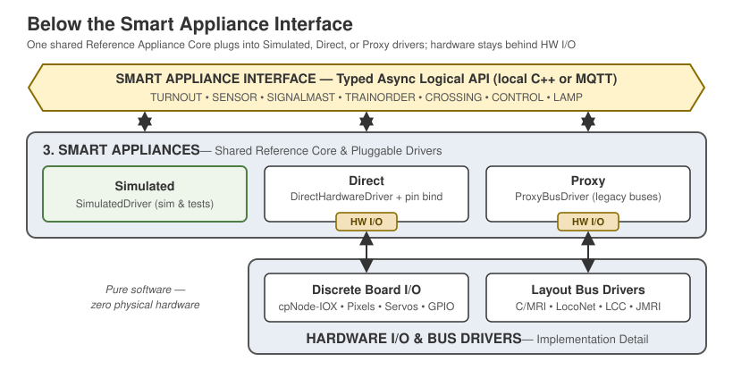
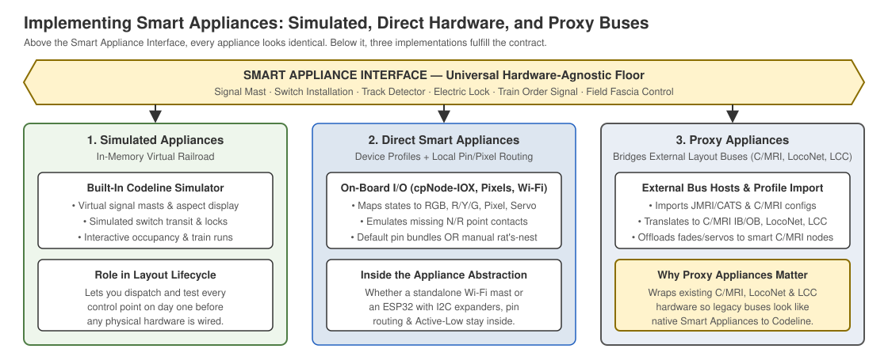
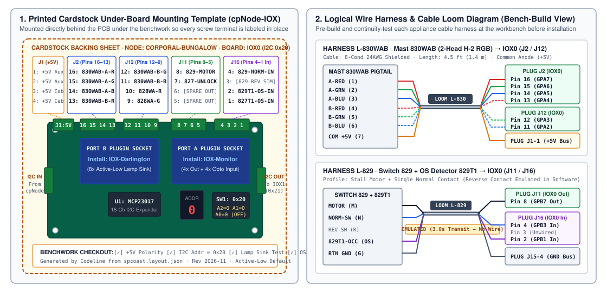

[Studio](Studio.md) · [Codeline](Codeline.md) · **[Smart Appliances](SmartAppliances.md)**  
↳ [Appliances](appliances/README.Appliances.md) · [Clusters](clusters/README.Clusters.md) · [C++ Binding](bindings/Cpp.md) · [MQTT Binding](bindings/MQTT.md) · **▸ Building** · *uPython Binding*
---
---

# Building & Wiring Smart Appliances

The [**Smart Appliances specification**](SmartAppliances.md) defines *what* an appliance is and *how* controllers talk to it. This document covers the **physical and driver layer below the Smart Appliance Interface**—how appliances are realized in software, wired to microcontrollers, bridged onto legacy layout buses, and documented for under-benchwork installation.

---

## 1. Reference Appliance Core & Three Pluggable Drivers

Above the Smart Appliance Interface, every appliance speaks the exact same Typed Async Logical API. Below it, a shared **Reference Appliance Core** (`TurnoutCore`, `SensorCore`, `MastCore`, `ControlCore`, `LampCore`—specified in [**`bindings/Cpp.md`**](bindings/Cpp.md) and repeatable in other runtimes such as MicroPython) implements all cluster state machines, `MAINTENANCE` gating, `HOLDOFF` timers, `POSITION` ramps, and `MAST` rulebooks once per runtime—delegating only minimal physical hooks across a narrow **Driver Port** (`ITurnoutDriver`, `ISensorDriver`, `IMastDriver`, ...) to **three interchangeable backends**:

### 1.1 Simulated Appliances (`SimulatedDriver` — Virtual Railroad & Functional Test Fixture)
Plugging an in-memory **`SimulatedDriver`** into the Reference Appliance Core yields the built-in virtual railroad—stepping turnouts through `IN_TRANSIT` timers, rendering signal aspects on screen, and injecting virtual train shunts before any hardware is wired. The same `SimulatedDriver` doubles as the **reference boilerplate stub** for new hardware drivers and as a **deterministic fault-injection test harness** (running the entire functional test suite in microseconds via `tick(now_ms)` over both direct C++ and MQTT loopback; see [**C++ Binding: Functional Test Framework**](bindings/Cpp.md#5-deterministic-functional-test-framework--transport-parity)).

### 1.2 Direct Smart Appliances (`DirectHardwareDriver` — Embedded MCU + Pin Binding)
An ESP32, Raspberry Pi Pico W, or bungalow controller driving local `cpNode-IOX` (`MCP23017`), `PCA9685` servo/PWM boards, NeoPixels, Tortoise motors, and microswitches binds the Reference Core directly to local I/O:

- **Signal Masts across Hardware Types**: Provision one `mast.rulebook` (`SP-1990`, `SPTCO-1960`, `GCOR-1995`) and bind heads to RGB H-2 searchlights (`Cluster:COLOR`), 3- or 4-lamp discrete heads (`Cluster:ON/OFF`), 2-wire `3MUX2A` multiplexed decoders, NeoPixel chains, or servo semaphores (`Cluster:POSITION`). The operational API remains identical across all of them.
- **Flexible Switch Feedback Regimes**: Under [`Cluster:TURNOUT`](clusters/README.Clusters.md#clusterturnout), `turnout.feedback_regime` supports `TWO_CONTACT` (Normal + Reverse microswitches), `ONE_CONTACT` (Normal switch + emulated Reverse), or `SIMULATED` (timed transit emulation when no point contacts are installed).

### 1.3 Proxy Appliances (Wrapping External `C/MRI`, `LocoNet`, `LCC`, and JMRI Buses)
Binding the Reference Core to a **`ProxyBusDriver`** presents the standard Smart Appliance API upward while bridging low-level bits, packets, or events across existing `C/MRI`, `LocoNet`, `LCC`, or legacy MQTT buses downward:

- **Upgrading 1-Bit Turnouts**: Wrapping a 1-bit C/MRI or MQTT turnout output with `turnout.feedback_regime = SIMULATED` gives it realistic `IN_TRANSIT` correspondence and full `OFFLINE` maintenance behavior.
- **Bit-Mapped vs. Smart Bus Nodes**: Against a classic C/MRI SMINI, the Proxy Appliance runs hardware binding and 1 Hz flashing in `OB[]` on the host; against smart Wi-Fi C/MRI nodes (such as Andrew Deak's nodes), the Proxy flips target bits in `OB[]` while the remote node executes incandescent fade ramps and servo profiles locally.

---

## 2. Hardware Bindings & Legacy Layout Import

Simulated endpoints, direct microcontrollers, and legacy bus proxies can run side by side on the same layout, following consistent physical wiring conventions:

- **Default Pin Bundles *or* Manual "Rat's-Nest" Routing**: For new construction, each hardware binding defines a contiguous **pin bundle** (e.g., 6 consecutive outputs on `IOX0` for a 2-head mast, or `M, N, R, OCC` for a switch) so an appliance drops onto a board port in one step. For existing layouts whose wiring grew organically across multiple cards, manual per-wire routing documents the exact pins as wired.
- **Layout-Proof Active-Low Defaults**: To avoid phantom occupancy from floating inputs and reduce short-circuit risk on long harness runs, **Active-Low** is the universal hardware-binding default (grounding inputs to assert, sinking current on outputs), with cascading overrides from layout-wide down to chip type, board, bank, or individual pin.
- **Migrating Existing JMRI, CATS, or C/MRI Layouts**: Rather than re-entering hundreds of hardware addresses—or keeping JMRI running solely as a middleman—existing JMRI, CATS, or C/MRI configuration files map directly onto **Proxy Appliances** (§1.3) to drive `C/MRI`, `LocoNet`, and `LCC` buses natively.

---

## 3. Benchwork Wiring Documentation & Firmware Packaging

Each Smart Appliance node combines its Reference Appliance Core, hardware driver, pin map, and chosen Local / Mirror / MQTT binding glue into ready-to-deploy microcontroller firmware (Arduino/ESP32 C++ or future MicroPython targets) alongside shop documentation built for working under the layout with a flashlight *(designed to be generated automatically from the layout model by [**Studio**](Studio.md))*:

- **1:1 Under-Board Cardstock Mounting Templates**: For I/O boards such as `cpNode-IOX` (and its PWM and Servo variants), a 1:1 scale cardstock backing sheet mounts directly behind the PCB on its standoffs. Around the perimeter—aligned with each 4-pin pluggable Phoenix terminal block (`Pins 16–1`), daughterboard socket (`IOX-Darlington`, `IOX-Monitor`), I²C header, and address DIP switch (`0x20`)—it prints wire names, colors, appliance IDs, and `[EMULATED]` / `[SPARE]` markers so the board carries its own permanent under-layout documentation.
- **Workbench Wire Harness & Cable Loom Diagrams**: Aviation-style harness drawings (`Loom L-830WAB`, `Loom L-829`) show the exact fan-in from each appliance pigtail, through the multi-conductor cable trunk, to the numbered pins on the mating Phoenix plugs (`J2`, `J12`, `J11`, `J16`) so harnesses can be built, labeled, and continuity-tested at the workbench.
- **NMRA Electrical & Prototype Bungalow Inspection Packets**: Block, turnout, and signal schematics suitable for **NMRA Master Model Railroader (Electrical AP)** documentation, alongside **AREMA / DOT-style bungalow checkout sheets** for verifying lamp current sink, polarity, and OS drop tests.
