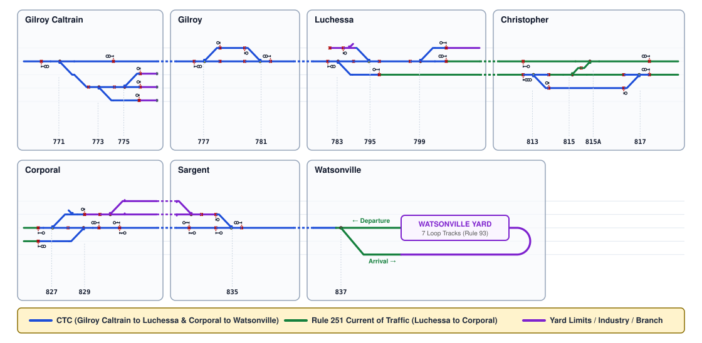
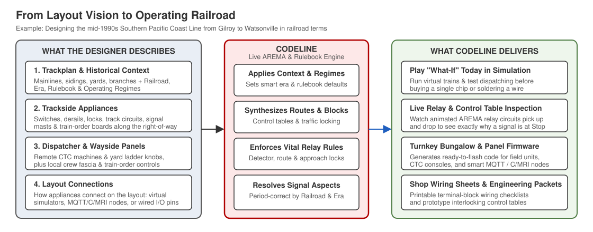
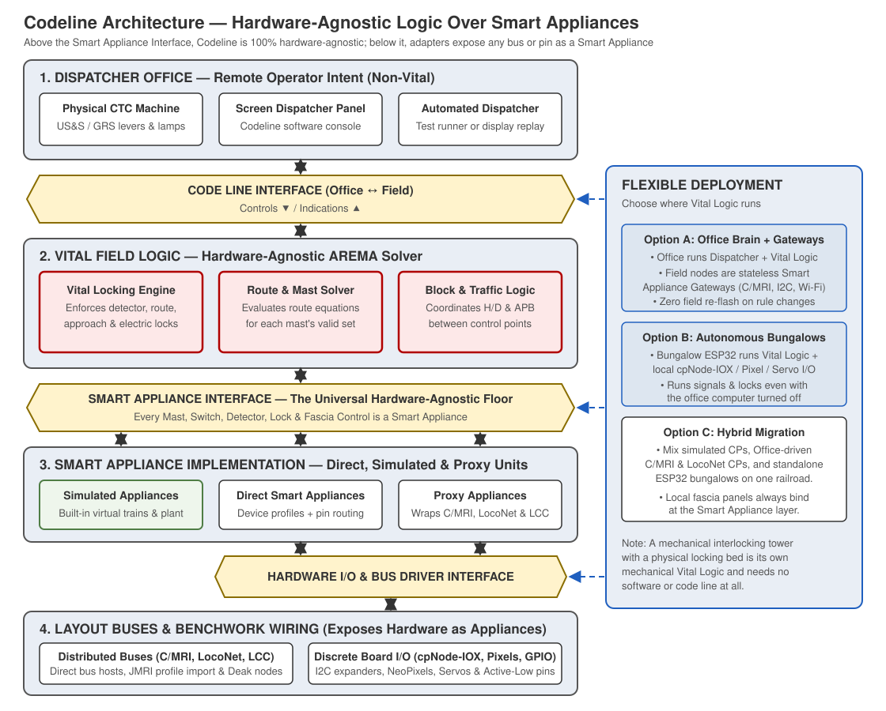
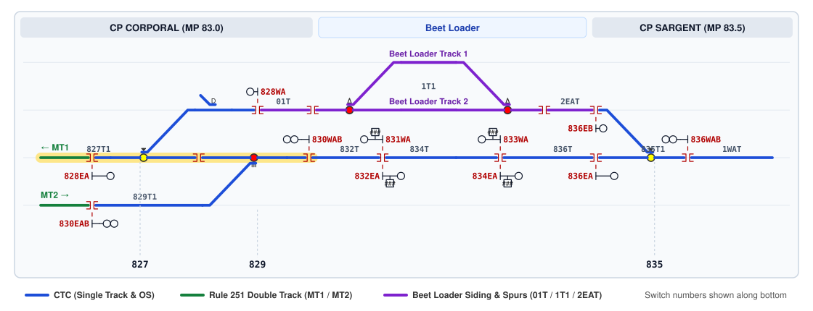
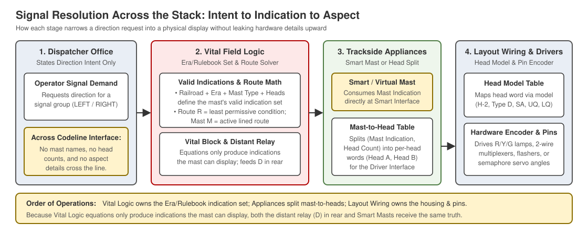
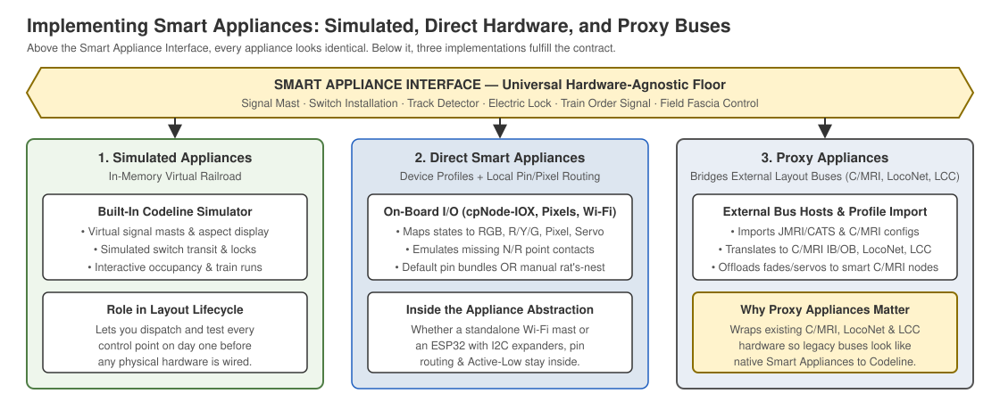
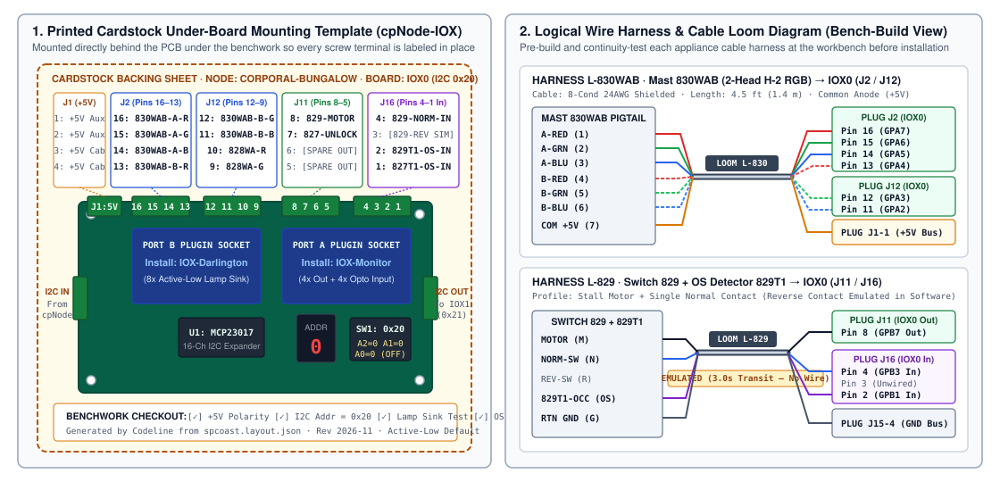

# Codeline: Designing, Simulating, and Operating Period-Correct Model Railroads

We are going to design a model railroad layout with **Codeline** to show off what it does. Our aspiration is to model Southern Pacific's Coast Line in the mid to late 1990s from San Jose to Watsonville, with dispatcher control of the layout from a US&S CTC machine. We will use modeler's license to selectively compress the geography and redefine a few locations to increase operational play value, while remaining faithful to Southern Pacific operating rules and signaling practice.

---

## 1. The Gap Between a Track Plan and an Operating Railroad

Model railroaders who build for prototype operations know the routine all too well. We have a track plan for our Coast Line subdivision, know a little bit about the mid-1990s SP era we want to capture, and have some concepts about how trains should move. We might even have heard about railroad rulebooks... Then you sit down to make it actually work:
- In **JMRI PanelPro**, you connect an I/O system like C/MRI, LocoNet, or LCC, assign logical user names across rows and rows of Turnout, Sensor, Signal Head, and Signal Mast tables, construct panels icon by icon, and spend forever programming Logix conditionals to keep track of every block boundary, turnout feedback sensor, route lock, and panel lamp.
- Or you step up to **CATS** (*Computer / Crandic Automated Traffic System*), which lets you start with a magnet board track diagram and grow it into a complete interlocking and APB logic driven system that is easier to set up, but still built on top of JMRI.
- You could even roll your own in QuickBASIC or Visual Basic using Bruce Chubb's comprehensive C/MRI handbooks for model railroaders.

Even with logical user names, signal templates, and example code, the learning curve is steep, and it all can quickly become overwhelming.  For some, the compromises involved don't align with their givens and 'druthers, such as the dependency on a central computer for everything.

**Codeline** bridges that gap. It is a tool for designing, simulating, and operating model railroad layouts in a flexible period-correct manner. Using it, the layout designer can focus on describing their idea, and Codeline makes it work.

### What is a model railroad layout?

A model layout is many things to many people.  It is complex and multifacited.  Historical research, crafting scenery, constructing benchwork, laying track, wiring and electronic hell. software and computers.  Arrrgh!  Where does one even start?  Here's what the journey might look like with Codeline:

1. **The Setting** for this layout is the Southern Pacific's Coast Division between Gilroy and Watsonville, including a few signature industries, yards, and branch lines.  We'll model Gilroy, both the Caltrain station and a bit of industry, the branch line to Hollister at Carnadero, the beet loader between Corporal and Sargent, and a staging yard at Watsonville.  These choices already nail down a bunch of unknowns:

   - Centralized Traffic Control (CTC) was installed on on specific single-track and junction segments rather than the entire route:

      - Gilroy to Watsonville : The segment from CP Corporal to CP Logan was equipped with CTC in 1959, an upgrade to the Automatic Block Signaling (ABS) system.
  
      - San Jose (CP Lick) to Gilroy Caltrain: When the Peninsula Corridor Joint Powers Board (Caltrain) took over Peninsula operations and extended commuter service to Gilroy in July 1992, the corridor between San Jose and Gilroy was upgraded from DTC/ABS to full CTC to handle the added passenger traffic. 
  
      - Much of the rest of the Coast Line and its branch tracks operated as a patchwork of CTC islands separated by long stretches of Direct Traffic Control (DTC) — and later Track Warrant Control (TWC) — overlaying Automatic Block Signals (ABS)
    
   - Southern Pacific converted from its Standard Code style rulebook to the General Code of Operating Rules (GCOR) in the late 1980s.

   - Because Caltrain in Gilroy is in the mix, the layout's era can't be earlier than 1992, when the creation of Caltrain's Joint Powers Board and service to Gilroy began. Unless we want to go the proto-freelanced route, the UP merger in 1996 brought an end to the Espee era, giving a short, bookended interval for our layout.
 
2. **The Trackplan**: In addition to a plethora of historical documentation available at the California State Railroad Museum archives in Sacramento and in online timetables, the Coast Line is still in active service, allowing for firsthand observation. We've chosen a few representitive control points to model:
   

3. **The Trackside Appliances**: Track and switches are the easy part compared to the details.  Codeline makes it easy to add signals, derails, hot box alarms, track circuits, even block and section boundaries - and, for earlier eras, train order boards, semaphores, and Maintainer Call lamps.
   
4. **The Dispatcher**: Codeline understands the nuances of the human interfaces that work the railroad, from a US&S CTC machine in the dispatcher's office, NX (eNter/eXit) controls for the staging yard, and local crew fascia controls for working the beet loader and Gilroy industry tracks.
   
5. **The Layout Connections**: None of the above is useful unless it can connect those appliances and panels to the devices on and under the layout. Since it may be a while until all this gets built, Codeline allows you to simulate and try out your trackwork designs immediately, document and test your wiring, connect to existing CMRI, LCC, LocoNet or IoT systems, and as projects get completed, deploy local firmware field unit logic to Arduino nodes on the layout.

6. **The Conventions**: Codeline uses prototype US&S CTC, AAR signal, and AREMA relay nomenclature throughout.
   - **Timetable Orientation and Even/Odd Parity**: Under Southern Pacific's historic system, movements toward San Francisco were designated **Westward (`W`)** and assigned **odd** numbers, while movements away from San Francisco (toward San Jose, Gilroy, and Los Angeles) were designated **Eastward (`E`)** and assigned **even** numbers—even along the Coast Line where the tracks run compass north and south. (When Caltrain transitioned its Peninsula Employee Timetable to **Northward / Southward** compass directions, it retained SP's historic odd/even numbering parity: Northward toward San Francisco is odd, and Southward toward San Jose and Gilroy is even—inverting the usual North American odd = South/West, even = North/East convention.) Because the bulk of our layout models the Southern Pacific, we use SP's **West (`W`) / East (`E`)** convention throughout this document.
   - **Switches and Signals**: Within interlockings, switches use **odd** numbers and signals use **even** numbers, keyed to the milepost on the trackplan (at Corporal, MP 83.0 East of San Francisco, Switches `827` and `829` are paired with Signal groups `828` and `830`).
   - **Signal Mast Names**: Combine the signal group, timetable direction (`W` = Westward toward San Francisco; `E` = Eastward toward Watsonville and Los Angeles), and head letters from top to bottom (`830WAB` = Signal `830`, Westward, heads `A` and `B`). Automatic block signals between control points carry odd numbers for Westward traffic (`831WA`, `833WA`) and even numbers for Eastward traffic (`832EA`, `834EA`).
   - **Track Circuits**: End in `T` (`832T` for a mainline block, `01T` for a siding, and `827T1` / `829T1` for the over-switch `OS` detector sections protecting Switches `827` and `829`).

With just a trackplan and the context we gathered above, we already have the beginnings of a functional representation of our layout. The appliances included in the trackplan provide the behavioral foundation for the railroad and enable the application of prototypical controls right away. Before you wire a single board under the layout, your CTC console and local panels can interact directly with simulated layout hardware so you can play "what-if" today—testing how a meet works between Corporal and Sargent, or seeing what changes on the layout if you roll the clock forward from 1960's flashing-red aspects to post-2000's lunar aspects.

When you are ready to build—or when you bring Codeline to an existing layout that is already wired—that same functional design helps generate your shop wiring diagrams, populates your MQTT and C/MRI configurations, and produces ready-to-run firmware for the Arduino or ESP32 field units under the layout.

---

## 2. A Subdivision Governed by Rules, Not Just Wires

On a real railroad, the density of traffic is directly proportional to the need for control—and to its cost. Centralized Traffic Control (CTC) is expensive to install and maintain; staffing mechanical interlocking towers around the clock is even more expensive. Instead of building the layout first and wondering how to signal and operate it afterward, Codeline makes it easy to explore and play with operating regimes while you design the trackplan:

- **Junctions and bottlenecks?** Make them **CTC (Standard Code Rule 261 / GCOR Chapter 10)**, where the dispatcher controls switches and absolute signals remotely from the office machine, as on our single-track Coast Line from Corporal to Watsonville.
- **A stretch of directional double track?** Make it **Rule 251 / 9.14 (Current of Traffic)**, where trains run with the established current of traffic on each track and you immediately eliminate the opposing signal masts. The double track from Luchessa to Corporal fits that bill, with a CTC island at Christopher for its power-operated crossover.
- **Long stretches of single track between towns or between control points?** Drop in Absolute and Permissive signals between interlockings for **Automatic Block Signaling (ABS)** (before the 1920s) and **Absolute Permissive Block (APB)** (after). These were a staple of western railroads across long runs of single track, automatically holding opposing trains at the head-blocks while letting following trains move ahead on permissive intermediate signals.
- **Busy switching districts or branch lines?** Establish **Yard Limits (Rule 93)** on the main track through Watsonville, govern the yard and Gilroy industry tracks at **Restricted Speed (Rule 105)**, and run the Hollister branch line under **DTC block authorities** (or **TWC track warrants**).

Because Codeline uses **vital logic** design principles, **era-specific practices**, and **railroad rulebooks** for its vocabulary and behavior, it can choose defaults that make the layout design process easier:

- **Real-world behaviors**: The field unit logic used in Codeline comes from the reference designs produced by the American Railway Engineering and Maintenance-of-Way Association (AREMA). Their materials cover track, structures, signals, and systems, many of which are relevent to model layout design and operation.

- **Fail-Safe Restrictiveness and Positive Control**: Just like a real track relay that drops by gravity when the track breaks or a battery dies, Codeline resolves uncertainties toward the safer/more restrictive state. Control messages on the code line use **positive control**, where vital demands are unambiguous: Instead of a boolean *IsNormal* whose negation implies Reverse, a demand for Switch 829 includes terms for both possible positions, *Normal* and *Reverse*, represented as `829NWS (829RWS)` for **829 Normal asserted** and **829 Reverse unasserted**, and `(829NWS) 829RWS` for Reverse.  This allows for a control packet with both demands unasserted that does not change an existing setting (`(829NWS), (829RWS)`).  Completing the possibilities, asserting BOTH (`829NWS, 829RWS`) is an invalid demand that is rejected by the field unit logic.
  
- **Modeler-Friendly Standalone Fallback**: On the prototype, if the dispatcher's code line goes dead, field signals stay at Stop and switches remain locked until crews receive verbal authority. On a model railroad, however, you sometimes just want to test equipment or run trains by yourself without a dispatcher. As an intentional modeler's option, when the office unit is offline, Codeline's field units can automatically drop back to local trackside operation—unlocking electric locks and dual-control switches and running the signals in a simple APB mode so your layout is always playable.

- **Smart defaults**: Place a crossover between `MT1` and `MT2` in Christopher, and Codeline can assume it is a remote-controlled power-operated crossover that has point feedback, over-switch (OS) occupancy detectors, and a switch lever on the dispatcher's console. Drop a siding switch onto Sargent's mainline and it defaults to a dispatcher-managed electrically locked switch with local fascia controls; drop another off the beet loader lead and it becomes a locally controlled motorized switch with fascia controls, no track circuit, and no dispatcher lever.

The choice of era has a direct impact the designer's equipment choices for a layout and the rulebooks that govern its operation:

### Rulebooks
  - **Early Fragmentation** (1830s–1880s). Individual railroads initially created their own operating rules, often printed as short pamphlets or on the backs of employee timetables. 
  - The **Standard Code** (1887–1889). Following the adoption of Standard Time in 1883, representatives of 48 railroads adopted the Standard Code of Operating Rules. It served as a foundational template for terminology, numbering, and train order movements, though individual roads still modified it for their own needs.
  - **CCOR** and **UCOR** (Mid-20th Century). As rail networks became more interconnected, shared regional rulebooks were developed to eliminate local variations. Examples included the Consolidated Code of Operating Rules and the Uniform Code of Operating Rules. Southern Pacific maintained its own independent rulebooks for most of its history before joining the 1985 GCOR consolidation
  - **GCOR** (1985–). Deregulation under the Staggers Rail Act of 1980 sparked massive railroad mergers and increased joint trackage agreements. In 1985, western and midwestern carriers merged the Consolidated and Uniform codes into the GCOR. Soon after, in 1988, eastern freight and commuter railroads formed the Northeast Operating Rules Advisory Committee (NORAC) to manage complex, high-density passenger and freight corridors.
  
### Equipment
   - **Turn of the 20th Century**: Southern Pacific installed its first Automatic Block Signals (ABS) in 1901 on the Coast alignment from San Francisco to San Bruno over Oceanview Summit using Union Switch & Signal **Style B two-position lower-quadrant semaphores** (first introduced in 1898). Because a lower-quadrant blade only had two positions (horizontal for `STOP`, dropped 60° for `CLEAR`), showing `APPROACH` required a two-blade home-and-distant mast (`Top = CLEAR, Bottom = STOP`). Early night roundels used White = `CLEAR`, Green = `CAUTION`, and Red = `STOP`.
   - **Pre-WWI**: In the early '20s, three-position **upper-quadrant semaphores** added a 45° diagonal `APPROACH` position on a single blade, enabling full route signaling on a two-head mast: the top head governs the straight route (`STOP`, `APPROACH`, `CLEAR`) while the lower head governs diverging routes (`STOP over APPROACH` for `DIVERGING_APPROACH`, `STOP over CLEAR` for `DIVERGING_CLEAR`). For safety against broken roundels, night lamp colors shifted to Green = `CLEAR`, Yellow = `APPROACH`, and Red (or any unexpected white light) = `STOP`.  
   - **WWI and the USRA**:  After the U.S. entered World War I in 1917, congestion and wartime logistics prompted the creation of the United States Railroad Administration.
   - **Mid Century**: Railroads introduced sleek, diesel-powered streamliners such as the Zephyr in 1934. After US&S introduced the **H-2 searchlight signal** in 1928, SP deployed searchlights across its Central Valley lines and by 1940 they were on the Coast Division mainline. While semaphores remained for years on many secondary and branch lines, most were gone by the 1980s. Combined with flasher relays and multi-head masts, searchlights supported four-aspect signaling and used **Flashing Red** on the SP through the 1950s and 1960s to indicate `RESTRICTING`.
   - **Post War**: By 1949, rail traffic had dropped 28% from its 1944 wartime peak and diesel-electric locomotives were replacing steam engines, reducing the need for steam servicing facilities and causing massive industry consolidation.
   - **1970s to Mid-1990s**: Starting in the late 1960s and accelerating through the 1980s and 1990s, SP transitioned its `RESTRICTING` and `APPROACH_RESTRICTING` aspects from Flashing Red to **Lunar White**, and around 1990 began supplementing H-2 searchlights with modular multi-lamp color-light heads under the General Code of Operating Rules (GCOR).
---

## 3. Walking the Architecture: From Dispatcher Office to Layout Wiring

Because layouts evolve over time, Codeline organizes the railroad into **four functional stages** connected by **plug-and-play interfaces**:
  1. **The Dispatcher Office**
     - Connected by the **Codeline Interface** to
  2. **The Field Unit with Vital Logic**
     - Connected by the **Smart Appliance Interface** to
  3. **Trackside Appliances and Fascia Controls**
     - Connected by the **Driver Interface** to
  4. **Layout Wiring and Drivers**

Like Lego blocks, an interface lets you unplug one block and snap in a completely different one without rebuilding the rest of the railroad.

- In the **Dispatcher Office**, you can plug in a physical 14-column US&S CTC machine, a Codeline-provided software dispatcher screen, or an automated test program.
- The **code line** itself is modular. From AAR tokens on an MQTT topic to bitwise encoding using LocoNet, CMRInet or CAN/LCC—even US&S Type 6 longs and shorts over a slot protocol if you build an electronic interface for it—Codeline supports many different transports and encodings.
- Before you even start building your layout (or long after), Codeline can emulate the **vital field logic**, allowing the dispatcher to exercise and test their CTC panels. With simple automations, it can even simulate trains operating on the virtual layout by triggering track circuits.
- For **trackside appliances**, you can use Codeline's built-in virtual train simulator today, swap in a JMRI or MQTT IoT signal mast tomorrow, and wire up an MCP23017 port expander under the layout next month—without changing a single rule in your vital interlocking logic.
- For **layout wiring and drivers**, you can decide how individual components such as signal heads, switch motors, and fascia lamps are driven, from animated C/MRI peripheral nodes to raw I2C and GPIO pins.

### Tracing a Move at CP Corporal: A Day in the Life of the Stack

Let's watch how these four stages and three interfaces work together during an operating session on our mid-1990s SP Coast Line.

A westbound freight from Watsonville has just been cleared past **CP Sargent** (`Mast 836WAB`) onto the single-track mainline toward **CP Corporal**, where single track expands into directional double track (`MT1` Westbound and `MT2` Eastbound) over **Switch 829**. When the dispatcher cleared `836WAB` at Sargent, traffic locking established westbound direction across the single track and the intermediate permissive block signals—**`833WA`** (governing block `834T`) and **`831WA`** (governing block `832T`)—lined up automatically ahead of the train, with `831WA` displaying `APPROACH` toward Corporal's westbound two-head US&S H-2 searchlight home signal, **Mast 830WAB** (currently at `STOP`).

Look closely at the trackplan for **CP Corporal**: why is the plant split into two switch-and-signal groups—**Switch 829 / Signal 830** (`829T1`) on the east and **Switch 827 / Signal 828** (`827T1`) on the west?
- Splitting Corporal into two interlocking sections allows **simultaneous parallel moves**: an eastbound train on `MT2` can line through `830EAB → Switch 829 Reverse` onto the single track at the same time a local switcher leaves the Beet Loader siding over `828WA → Switch 827 Reverse` heading west onto `MT1`.
- For our through westbound freight staying on the main track (`830WAB` protecting the route through `Switch 829 Normal → Switch 827 Normal → MT1`), its path crosses **both** plant sections (`829T1` and `827T1`). Because there is no separate intermediate home mast between `829` and `827` on the main track, clearing **Mast 830WAB** onto `MT1` requires **both** `Switch 829 Normal + Signal 830 Left` and `Switch 827 Normal + Signal 828 Left`.

#### The Dispatcher and the Codeline

Sitting at the CTC machine, the dispatcher lines the westbound freight straight through Corporal onto `MT1`: they verify Beet Loader siding **Switch Lever 827** is `NORMAL`, set main-track **Switch Lever 829** to `NORMAL`, turn both **Signal Lever 830** and **Signal Lever 828** to `LEFT` (westbound), and press the station's **CODE** button.

Notice what the dispatcher and the CTC machine know—and what they deliberately *do not* know. The CTC console does not know how many signal masts stand at **Corporal**, the mast's name (`830WAB`), how many heads are on that mast, what colors its lenses are, or how the individual route equations are wired. The dispatcher only specifies the **controls for the route being requested**: Switches `827` and `829` Normal, and Signal groups `828` and `830` Left.

Pressing the code button sends one atomic control packet across the **code line**. Because the dispatcher's levers are free-moving—unlike an older tower's mechanical locking bed—the code line carries non-vital, positive-control demands (`827 Normal, 829 Normal, 828 Left, 830 Left`) down to the field, which the field unit will ignore if unsafe, and carries verified office indications back up to light the machine's panel lamps.

#### The Vital AREMA Solver in the Field Bungalow

On the other end of the codeline, the field unit for CP Corporal receives the dispatcher's frame. Conceptually located in the maintainer's bungalow, its vital relays (or microprocessor firmware implementing that relay logic) decode and evaluate the demands against the plant's safety locks.

Even though switch and signal demands arrive in the same code transmission, vital interlocking in the field bungalow enforces a strict sequence before any signal can clear:
- **Detector, Route, and Approach/Time Locking**: Are both over-switch detectors (`827T1` and `829T1`) vacant? Are opposing eastbound signals (`828EA` and `830EAB`) held at Stop with no approach or time-locking timer running? If a section is occupied or locked, the vital field logic rejects that movement and nothing moves in the field.
- **Switch Movement First**: If any requested switch is not yet in position, the field unit energizes its switch control relay to align the points.
- **Switch Correspondence Check**: While switch points are in transit, the switch is "out of correspondence" and both its Normal and Reverse indication lamps on the dispatcher's board are dark. Vital logic prevents any signal relay over that switch from picking up until the points are fully thrown, locked, and electrically verified.
- **Signal Clearing Second**: Once Switches `829` and `827` are proven locked in Normal, vital logic verifies that `829T1`, `827T1`, and the `MT1` block ahead (`Christopher:2WAT`) are unoccupied and that both `830` and `828` are requested Left, then clears `830WAB`.
- **Indication Return**: As the switches lock and the signal clears, the field station transmits an indication code (`827NWK, 829NWK, 828WGK, 830WGK`) back to the office to light the corresponding switch and signal lamps on the dispatcher's machine.

Here is where Codeline's signal model shines. When we placed the two-head controlled mast `830WAB` on the trackplan, we did **not** have to write boolean aspect equations or configure head capabilities mast by mast. The combination of **Railroad (`SP`), Era (`1995`), Mast Type (`CONTROLLED`), and Head Count (`2`)** automatically gives `830WAB` the modern Southern Pacific route-signaling indication set (`STOP`, `RESTRICTING`, `DIVERGING_RESTRICTING`, `APPROACH`, `DIVERGING_APPROACH`, `ADVANCE_APPROACH`, `DIVERGING_CLEAR`, `CLEAR`) and defaults its heads to US&S H-2 searchlights.

The vital solver calculates Mast `830WAB`'s indication directly from its route equations:
- Along each route originating at `830WAB`, it checks every condition in series—the required switch alignments (`829 Normal` and `827 Normal` for `MT1`; `829 Reverse` for `MT2`), switch correspondence, OS track occupancy (`829T1` and `827T1`), authority from the signal levers (`830 Left` and `828 Left`), and the occupancy and next-signal state of the block ahead—taking the **least permissive** condition on that route.
- Across all routes originating at `830WAB`, it takes the **most permissive** result. Because any route whose switches are not aligned and locked in correspondence evaluates to `STOP`, at most **one** route—the physically lined route—can ever be more permissive than `STOP`.
- Crucially, because the route equations only produce indications that `830WAB` can actually display, `830WAB`'s distant relay (`830DR`) immediately feeds that truth back down the single track to intermediate signal **`831WA`** (upgrading `831WA` from `APPROACH` to `CLEAR`, which in turn cascades back to **`833WA`** and **`836WAB`** at Sargent).

For our westbound move at CP Corporal along the straight route onto `MT1` (`829` Normal, `827` Normal, `830` and `828` Left) toward a next signal at Stop in Christopher, Codeline's vital logic determines that Mast `830WAB` should display `APPROACH`, updates its vital block state for `831WA` in rear, and reports the office indications back across the **code line** to light the dispatcher's panel lamps.

#### Trackside Appliances, Fascia Controls, and Layout Wiring

Once the **vital field logic** has verified that Switches `829` and `827` are locked Normal and decided that Mast `830WAB` should display `APPROACH`, how does that decision become a physical yellow-over-red signal and a locked turnout on the layout?

Most layout control systems jump straight from logic equations to **raw wires and I/O pin numbers**—scattering a single turnout or signal mast across a spreadsheet of unrelated bits (`Output 14` for a Tortoise motor, `Inputs 3 and 4` on another board for point microswitches, `Input 11` for the track detector, `Outputs 22–27` for six LED wires on a mast). Change how a signal head is wired, or swap a simulated turnout for a physical one, and your layout breaks.

Codeline avoids that trap by separating **functional appliances** (complete railroad units) from **layout wiring and drivers** (how their physical devices are wired under the benchwork):
- **An appliance is a complete, functional railroad object**: To the vital logic, `Mast 830WAB` is simply a signal mast that accepts a railroad indication (`APPROACH`), and `Switch 829` is a complete switch installation that accepts a throw command (`NORMAL` / `REVERSE`) and reports its point correspondence and OS occupancy.
- **Simulated or smart IoT appliances stop right here**: If Corporal is running in **Codeline's simulator** or driving a **plug-in smart IoT mast**, the appliance receives `APPROACH` directly and displays it—no head tables, encoders, or pin numbers required.
- **Wired appliances translate cleanly into device channels and drivers**: When `830WAB` is built from **discrete electronics** under the benchwork (say, a pair of US&S H-2 searchlight heads wired to an I2C expander), Codeline translates `APPROACH` on that two-head route-signaling mast into per-head demands (**Head A = `APPROACH`**, **Head B = `STOP`**) and passes them to the **device driver**, which energizes the Yellow output on Head A and the Red output on Head B.
- **Local fascia controls are field appliances too**: Corporal's trackside crew controls—the electric lock release on Switch `827` and the local fascia toggle for Beet Loader Switch `1`—also live right here on the field unit, mediated locally by the bungalow without ever touching the code line.

With the yellow-over-red `APPROACH` aspect lit on Mast `830WAB`, our westbound freight passes `831WA` on a green, rolls through Corporal onto `MT1` prepared to stop at the next signal, and the OS sections release behind the caboose.

---

## 4. From Functional Appliances to Trackside Devices and Layout I/O

Separating **functional appliances** from **trackside devices and layout wiring** is what lets a layout evolve smoothly—whether you are starting from a blank sheet on your laptop or bringing Codeline to an existing layout with twenty years of accumulated under-table wiring.

**Every appliance on the railroad is treated as a smart appliance**. Codeline's vital field logic never needs to know whether an appliance is simulated in software, networked over Wi-Fi, or soldered to terminal blocks—it simply says: *"Mast `830WAB`: show `APPROACH`"* or *"Switch `829`: align `NORMAL` and report your point contacts and OS occupancy."*

Codeline connects your trackplan appliances to the layout in **three ways**, mixing and matching them freely:

### 1. Plug In a Smart or Virtual Appliance Directly
Suppose you are running **virtual simulation in Codeline**, or using **MQTT / JMRI** to connect to Dave Falkenburg's Wi-Fi MicroPython signal masts and crossing controllers. Those endpoints already speak railroad terms! The vital logic sends `APPROACH` directly to the `830WAB` mast appliance, and the smart mast lights its own LEDs following the rulebook conventions it was configured to use. Plug and play—zero pins or bit tables required.

### 2. Translate Appliances into Trackside Devices (and Synthesize Missing Sensors)
Most layouts are built from physical **trackside devices**: RGB or discrete LEDs in signal heads, Tortoise stall motors, microswitches, optical photosensors, relays, and fascia toggle switches.

Instead of forcing you to play Erector Set with custom encoder logic for every mast and turnout, Codeline uses **device profiles** that translate a functional appliance state directly into the digital outputs and inputs its physical devices require—and **emulates missing hardware sensors** when your layout doesn't have them:
- **Signal Masts to Lamp and Servo Channels**: Tell Codeline that `Mast 830WAB` uses a pair of **RGB H-2 searchlights**, and `APPROACH` translates into **`Head A = [R=1, G=1, B=0]` (Yellow), `Head B = [R=1, G=0, B=0]` (Red)**. Pick a **3-lamp Type D profile**, and it drives `[R=0, Y=1, G=0]` and `[R=1, Y=0, G=0]`; pick a **2-wire multiplexed searchlight decoder**, and it outputs `[0, 1]` and `[1, 0]`; pick a **semaphore profile**, and it outputs the blade servo angle plus the night lamp bit. When a head receives `RESTRICTING`, a 1960s 3-lamp searchlight profile flashes the Red bit at 1 Hz—whereas a 1990s 4-lamp profile lights the fourth Lunar bit instead.
- **Switches with Full, Partial, or Simulated Point Feedback**: Above the appliance boundary, vital field logic always expects a power switch like `Switch 829` to report both `Normal` and `Reverse` point correspondence. Under the benchwork, however, if your turnout motor only has a single `Normal` microswitch—or no point contacts at all—you don't have to dumb down your interlocking logic! The switch appliance simply **simulates the missing point sensors** (dropping correspondence for a realistic transit time when the motor bit flips, then asserting correspondence for the new alignment).
- **Local Trackside, Fascia, and Maintainer Controls**: Local crew controls—the electric lock button on Switch `827`, the fascia toggle for Beet Loader Switch `1`, depot train-order levers, and bungalow maintainer test switches—are simply digital inputs and indicator outputs on the **field unit**, mediated locally by the bungalow's vital logic without ever touching the code line.

### 3. Map Device Bits to Hardware: Distributed Buses, Pin Bundles, or "Rat's-Nest" Wiring
Once an appliance's device profile has produced its digital input and output bits, Codeline's **hardware I/O drivers** route those bits to wherever your hardware lives—supporting both clean new builds and the messy reality of existing layouts:
- **Distributed Layout Buses (`CMRInet`, `LocoNet`, `LCC`)**: Codeline packs the device bits into C/MRI transmit/receive frames, LocoNet messages, or LCC events. A bit transition can drive a classic C/MRI SMINI output pin directly—or land on a smart peripheral like Andrew Deak's Wi-Fi C/MRI node, where a `0 → 1` bit transition triggers a scripted incandescent fade ramp or a slow-fast-slow turnout servo motion profile on the remote board.
- **Direct Field-Unit Boards (`I2C Expanders`, `PWM`, `GPIO`)**: Or you can bind those same device bits directly to `MCP23017` / `MAX7313` I2C port expanders, `PCA9685` PWM boards, shift registers, or microcontroller GPIO pins on the bungalow processor (and reuse those exact same drivers on the office side of the code line to read the handles and light the lamps of a physical US&S CTC machine).
- **Suggested Pin Bundles *and* "Randomly Wired" Templates**: For new construction, each appliance offers a suggested **pin bundle** (e.g., 6 consecutive outputs for a 2-head mast, or `M, N, R, OCC` for a switch) so you can drop an appliance onto a board port in one step and print a clean Shop Wiring Sheet. For existing layouts that have grown into a rat's nest over the years—where Head A's Red wire is on Board 1, Yellow is on Board 3, and the OS detector is on a LocoNet card—a **randomly wired template** lets you point every individual wire to any pin on any board or bus, documenting your actual benchwork as it exists.
- **Reverse Import & Live Discovery**: Rather than typing existing hardware addresses in by hand, Codeline can work bottom-up—**importing C/MRI bit maps, reading JMRI and CATS XML configuration files, or querying an MQTT broker** to discover existing turnouts, sensors, and smart appliances so you can bind them straight onto your trackplan.
- **Layout-Proof Active-Low Defaults**: Electrical noise on high-impedance inputs causes phantom occupancy, and driving high-current positive outputs ends badly the day someone drives a staple through a cable. Codeline makes **Active-Low** the universal hardware default (grounding inputs to assert, sinking current on outputs to light lamps), while providing a cascading override (from layout-wide down to chip type, board, bank, or individual pin) for any active-high device that needs an exception.

### 4. Benchwork-First Wiring and Engineering Documentation
Instead of leaving you with an abstract CAD schematic that is useless when you are lying on your back under the layout with a flashlight, Codeline generates **physical benchwork and engineering documentation** directly from your hardware bindings:

- **1:1 Under-Board Cardstock Mounting Templates**: For physical I/O boards like `cpNode-IOX` (and its PWM and Servo variations), Codeline prints a 1:1 scale cardstock backing sheet that mounts directly behind the PCB on its standoffs. Printed around the perimeter of the board—lined up with each 4-pin pluggable Phoenix terminal block (`Pins 16–1`), daughterboard socket (`IOX-Darlington`, `IOX-Monitor`), I2C chain header, and address DIP switch (`0x20`)—are the exact wire names, colors, appliance sources, and `[EMULATED]` / `[SPARE]` markers. The board itself becomes its own permanent, in-place documentation under the layout.
- **Workbench Wire Harness & Cable Loom Diagrams**: Before you ever crawl under the benchwork, aviation- and industrial-style harness drawings (`Loom L-830WAB`, `Loom L-829`) show the exact fan-in from each appliance pigtail, through the multi-conductor cable trunk, to the numbered pins on the mating Phoenix plugs (`J2`, `J12`, `J11`, `J16`)—so you can build, label, and continuity-test each cable harness comfortably at the workbench.
- **NMRA Electrical & Prototype Bungalow Inspection Packets**: From the same model, Codeline outputs clean block, turnout, and signal schematics suitable for **NMRA Master Model Railroader (Electrical AP)** Statement of Qualification packets, alongside **AREMA / DOT-style bungalow checkout and maintenance logs** for verifying route locking, lamp current sink, and OS drop tests.

---

## 5. Pulling It All Together: Codeline as Your Live Railroad Workshop

When you put these pieces together inside **Codeline**, the workflow feels less like programming a computer and more like working with a live, interactive model board that understands railroad engineering:

1. **Sketch and Play with Regimes**: Lay out your Coast Line corridor from San Jose to Watsonville, pick your Railroad, Era, and Rulebook, and experiment with operating regimes—making high-density interlockings CTC, directional double track Rule 251, and long single-track APB runs, all without worrying about aisle widths!
2. **Place Appliances and Operate Immediately**: Drop switches, crossovers, derails, insulated joints, train-order signals, and signal masts onto the trackplan. Because Codeline embeds the **vital field logic** live inside the editor, feedback is immediate. Routes, control tables, and block `HD` links synthesize on the fly. You can immediately drag a virtual train onto the track, throw levers on a virtual CTC console, click any signal or switch to watch the code-line packets flow, and dive into a live **animated AREMA relay circuit diagram** (`HR`, `DR`, `HSR`, `ASR`, `WLR`, `KR`, `TR`, `SR`) picking up and dropping in real time.
3. **Connect Your Layout Incrementally**: As you build panels and wire benchwork—or as you bring an existing wired layout into Codeline—connect your appliances one at a time to plug-in MQTT/JMRI smart endpoints, animated C/MRI peripheral nodes, or physical expander and GPIO pins under the table. You can even run a hybrid operating session with an on-screen CTC machine, several ESP32 field units, a handful of CMRInet nodes, and the rest in emulation.
4. **Generate Everything from One Truth**: With one click, Codeline projects your verified design into ready-to-flash microcontroller firmware, JMRI/MQTT topic definitions, printable Shop Wiring Checklists, and complete prototype-inspired AREMA Interlocking Engineering documentation packets.

## 6. Appendix
**Code line assignments**: The AREMA Communications & Signals Manual (Section 16, Vital Circuits, and standardized AAR/AREMA circuit nomenclature), uses letter combinations form standardized circuit designations used on written circuit plans, interlocking sheets, and Centralized Traffic Control (CTC) code-line assignments.

Each designation reads from left to right as a stack of modifiers culminating in a core functional device or state, with individual letters carry specific meanings depending on their position in the string:

  - N / R (Position): Normal or Reverse.
  - W (Switch): Switch operating mechanism or switch function.
  - G (Signal): Signal operating mechanism or signal function.
  - W / E (Direction): Westward or Eastward (when prefixing a signal designation).
  - H (Home / Approach): Home signal or the approach/restricting/stop-and-proceed control state.
  - S (Stick / Demand): Stick relay or non-vital/code-line control demand. In CTC and office-to-field interfaces, S frequently denotes a transmitted control Step or stick demand from the dispatcher's machine.
  - K (Indication): K represents an Indicator, indication relay, or field-to-office indication bit.

**Switches**: The following terms govern the movement demands and position verification indications of a power-operated turnout or crossover.
   - `NWS` (Normal Switch Stick / Control Demand): Requests the switch to move to and lock in the Normal position. In CTC or vital interlocking logic, energizing NWS initiates the vital switch control relay (NWR) if all locking checks (route, detector, time, and approach locking) are clear.
   - `RWS` (Reverse Switch Stick / Control Demand): Requests the switch to move to and lock in the Reverse position. Energizing RWS drives the vital reverse switch control relay (RWR), provided the switch is unlocked and free of track occupancy.
   - `NWK` (Normal Switch Indication): Confirms that the switch points are physically closed against the stock rail in the Normal position and mechanically locked. In the field, this is driven by the vital Normal Switch Repeater (NWPR); over a CTC code line, NWK is the indication bit that lights the normal green/white lamp on the dispatcher's control panel
   - `RWK` (Reverse Switch Indication): Confirms that the switch points are physically closed and locked in the Reverse position. Driven by the Reverse Switch Repeater (RWPR), RWK illuminates the reverse lamp on the control panel and proves correspondence before a route over the diverging leg can be cleared.

**Signal** demands control the directional signal clearing, while indications convey feedback proving that a signal has either cleared or returned to Stop.
   - `WGS` (Westward Signal Stick / Control Demand): Requests a Westward signal to clear. When the dispatcher or automatic routing logic sends a clear command for a westbound move, WGS picks up to request the vital signal control relays (HR/DR) for the lined route.
   - `EGS` (Eastward Signal Stick / Control Demand): Requests an Eastward signal to clear. It functions identically to WGS for eastbound movements, initiating the vital route and locking checks required to clear the opposing signal.
   - `HS` (Hold Signal Stick): Sent from the dispatcher's machine when the signal lever is placed in the center STOP (N) position to knock down / cancel a cleared signal. Knocking down the signal while the approach is occupied drops the vital Approach Stick Relay (ASR / HSR), which starts the Time Element Relay (TER).
   - `WGK` (Westward Signal Indication): Indicates to the control office or interlocking panel that a Westward signal is displaying a proceed aspect (anything more favorable than Stop). When WGK drops, it confirms all westward signals at that control point are displaying Stop.
   - `EGK` (Eastward Signal Indication): Indicates that an Eastward signal is displaying a proceed aspect. Together, WGK and EGK provide the vital "signal clear" vs. "signal at stop" status on the dispatcher's track diagram, governing when fleet logic or route releases can occur.
   - `TEK` (Time-Locking Indication): While the Time Element Relay (TER) is actively counting down, this illuninates a Time-Locking / Route-Locked lamp.

Other **Relays**
 - TR (Track Relay): Detects train occupancy in a specific track section (e.g., the OSTR for the switch OS section, or approach ATRs). De-energized (TR down) when shunted by a train.
 - KR (Indication / Correspondence Relay): A vital field relay verifying physical correspondence—most commonly NWKR/RWKR (confirming the switch points are locked in agreement with the control) or RGKR (confirming the signal is displaying Stop).
 -  HR (Home Relay): The primary vital signal control relay. When energized (HR up), it permits the signal to display a basic proceed aspect (e.g., Approach/Yellow), provided the route is locked and clear.
 -  DR (Distant / Clear Relay): The secondary vital signal control relay. Cascaded above HR, it energizes only when HR is up and the next signal in advance is also displaying a proceed aspect, upgrading the aspect to Clear (Green).
 -  ASR (Approach Stick Relay): Works alongside or in place of HS to enforce approach locking. It stays energized while the approach track is clear, drops when a signal is cleared with an approaching train, and requires either the train to pass (OSTR drop) or the TER to expire before re-energizing.
 -  WLR (Switch Lock Relay): The master vital lock relay for a switch (often paired with or substituting for LS). All switch control circuits (NWR/RWR) must pass through a front contact of WLR. If WLR is down, the switch cannot move.
 -  SR (Stick Relay): A general-purpose vital memory relay (such as a directional stick relay WSR/ESR or route stick) that "remembers" a train's direction of travel so the route locks ahead of the train and releases behind it as consecutive TRs drop and pick up.