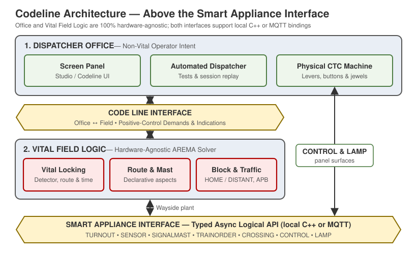
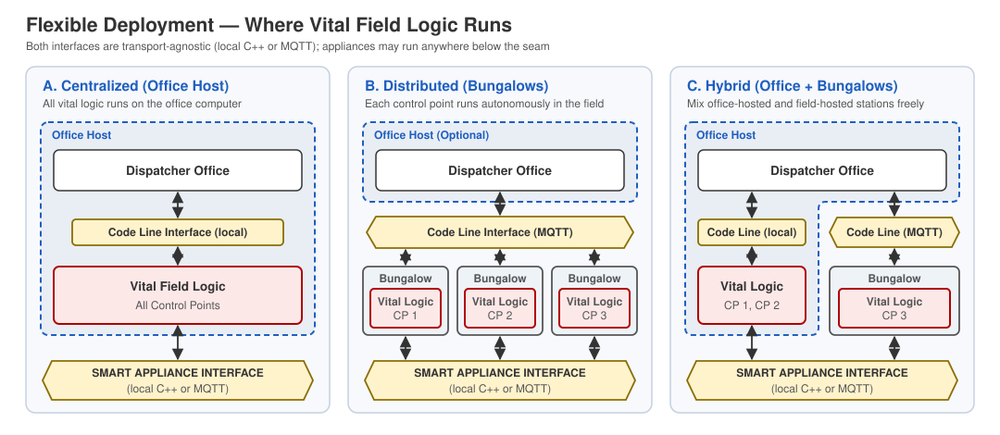

[Studio](Studio.md) · **▸ Codeline** · [Smart Appliances](SmartAppliances.md)  
↳ [Walkthrough](Walkthrough.md)
---

# Codeline: Prototypical Railroad Logic and Architecture

**Codeline** is the operational signaling and control runtime designed in [**Studio**](Studio.md) and backed by [**Smart Appliances**](SmartAppliances.md). Grounded in **AREMA Communications & Signals** practice and historical railroad rulebooks (see [**Background**](Background.md)), Codeline separates *how the railroad operates* from *how the benchwork is wired*.

---

## 1. A Subdivision Governed by Rules, Not Just Wires

On the prototype, traffic density determines where railroads invest in signaling and control. Codeline lets you combine multiple operating regimes across a single subdivision, each enforcing its own rulebook semantics:

- **Centralized Traffic Control — CTC (Standard Code Rule 261 / GCOR Chapter 10)**: Remote dispatcher control of power switches and absolute home signals from an office CTC machine across high-density junctions and single-track bottlenecks (such as CP Corporal to CP Logan).
- **Current of Traffic (Rule 251 / GCOR 9.14)**: Directional double track where trains move with the established current of traffic on each track and opposing intermediate signals are omitted (such as Luchessa to Corporal, with a CTC crossover island at Christopher).
- **Automatic Block & Automatic Permissive Block (ABS / APB)**: Single-track block signaling between control points. APB tumbles opposing signals to `STOP` head-block to head-block while allowing following trains to advance behind one another on permissive intermediate signals.
- **Yard Limits (Rule 93), Restricted Speed (Rule 105), and DTC / TWC**: Unsignaled or lower-density territory—yard mains, industrial leads, and branch lines governed by block authorities or track warrants.

### Engineering Principles

- **AREMA Vital Logic**: Interlocking, route, detector, approach, and time locking follow AREMA reference designs so unsafe dispatcher demands are rejected in the field rather than trusted at the office console.
- **Fail-Safe Restrictiveness & Positive Control**: Uncertainty always resolves toward the more restrictive state (`STOP`, occupied, out-of-correspondence). Code-line commands use **positive control** with explicit complementary terms—`829NWS (829RWS)` demands Switch `829` Normal, `(829NWS) 829RWS` demands Reverse, `(829NWS) (829RWS)` leaves the current alignment unchanged, and asserting both (`829NWS 829RWS`) is rejected as invalid. (See [**Background: Code-Line & Vital Relay Guide**](Background.md#4-uss-code-line-and-arema-vital-relay-guide).)
- **Executive-Owned Vital Fail-Safe Substitution**: Smart Appliances report honest physical state rather than encoding railroad-role fail-safe logic. Inside Codeline, unproven appliances initialize restrictively at startup, and whenever an appliance disconnects (MQTT LWT), enters maintenance (`/event OFFLINE`), or emits a vital fault (`/event FAULT`), Codeline substitutes the role-appropriate fail-safe state in vital logic:
  - Track-circuit `SENSOR` → `ACTIVE` (Occupied)
  - `TURNOUT` → `(NORMAL) (REVERSE)` (Out of correspondence; no route can clear over it; operational switch commands are withheld while unhealthy)
  - `SIGNALMAST` → **`STOP` for indication uses** (office `GK`, next signal's `DISTANT`), and **not proven at `STOP` for locking uses** (`RGKR`, starting `TER`, releasing route locks — because an unhealthy mast may still be displaying a proceed aspect in the field)
  - Electric switch lock `CONTROL` → **not proven locked** (`WLK` / `lock/RELEASED` asserted; protecting signals held at `STOP`). *(On restart or control loss, the field still withholds its release output so the physical lock stays locked; fail-safe substitution applies whenever the lock's closed contact cannot be proven.)*
- **Re-Admission Without Unrequested Motion**: When an appliance recovers and passes health proof (`exportAttributes()`), vital logic adopts a turnout's current physical position without sending an unrequested throw, and no signal re-clears on its own when an appliance returns.
- **Modeler-Friendly Standalone Fallback**: On the prototype, a dead code line leaves field signals at `STOP` until crews obtain verbal authority. As an explicit modeler's option for solo running without a dispatcher, Codeline's field units can fall back to local trackside operation—unlocking electric locks and dual-control switches and running signals in standalone APB mode.

---

## 2. Three Layers, Two Clean Interfaces

Codeline separates the railroad into three layers connected by two crisp interfaces:

1. **The Dispatcher Office** — US&S CTC machine, software panel, local fascia plates, or automated test runner built on [`Appliance:CONTROL`](appliances/README.Appliances.md#appliancecontrol) and [`Appliance:LAMP`](appliances/README.Appliances.md#appliancelamp) operator surfaces. A physical CTC machine uses **both** interfaces: the **Code Line Interface** toward Vital Field Logic, and the **Smart Appliance Interface** (bound locally in-process—e.g., C++—when its switch/lamp I²C boards sit inside the machine, or over MQTT when decoupled) for its physical levers and lamps.
   - Connected via the **Code Line Interface** *(US&S/AAR positive-control demands and office indications)* to
2. **The Vital Field Logic** — Hardware-agnostic AREMA locking, route evaluation, and block solver.
   - Sitting above the **Smart Appliance Interface** *(typed async logical commands, physical state, and events — bound locally in-process or over MQTT)* over
3. **Smart Appliances** — Simulated, Direct Microcontroller, or Proxy hardware endpoints built on the Reference Appliance Core + Driver Port pattern (see [**Smart Appliances**](SmartAppliances.md)).

Above the **Smart Appliance Interface**, Codeline is 100% hardware-agnostic: the Dispatcher Office and Vital Field Logic never touch a pin number, an I²C address, a C/MRI bit offset, or an LED color. Both interfaces follow the same **Logical Contract + Pluggable Language/Transport Binding** pattern (starting with the [**C++ In-Process Binding**](bindings/Cpp.md) and [**MQTT Binding**](bindings/MQTT.md), while keeping the contract open to runtimes such as MicroPython).

Below the **Smart Appliance Interface**, every endpoint exposes the same typed async contract whether it runs purely in software (`Simulated`), directly on local board I/O (`Direct`), or bridged onto a legacy layout bus (`Proxy`):

---

## 3. The Code Line Interface vs. The Smart Appliance Interface

Keeping the two interfaces distinct preserves prototype fidelity at the office without leaking relay jargon into generic hardware—while reusing the exact same transport/encoding separation on both seams:

- **Code Line Interface (Office ↔ Vital Field Logic)**: Carries non-vital, complete, atomic station control frames (`CHART 85973c19 829NWS (829RWS) (827WLS) 828WGS (828EGS) (828HS) 830WGS (830EGS) (830HS) (1MCS)`) from free-moving CTC levers down to the field station, and verified complete station indication frames (`CHART 85973c19 829NWK (829RWK) (827WLK) (827WLQK) 828WGK (828EGK) (828TEK) 830WGK (830EGK) (830TEK) (1MCK) (827T1K) (829T1K)`) back up to light panel jewels. The office console never knows how many masts stand at a control point, how many heads a mast carries, or how route equations are wired.
- **Smart Appliance Interface (Vital Field Logic / Office Panels ↔ Hardware)**: Translates solved vital outputs and panel lamp frames into typed, hardware-neutral commands (`setAlignment(NORMAL)`, `setIndication(APPROACH)`, `setLamps(...)` — encoded on MQTT as `NORMAL (REVERSE)`, `APPROACH`, `LAMP1 (LAMP2)`) and consumes closed-loop physical state confirmations before advancing any vital sequence.

---

## 4. Vital Field Logic and Declarative Signal Resolution

When a control packet arrives across the Code Line Interface, the station's vital logic enforces a strict interlocking sequence before any signal clears:

1. **Detector, Route, and Approach/Time Locking**: Verify over-switch (`OS`) and route track circuits are vacant (`(ACTIVE)`), opposing signals are proven at `STOP` (`RGKR` up), and no approach- or time-locking timer (`TER`) is running on the lever. Unsafe demands are rejected with no field motion. At field startup, routes initialize conservatively as if their signals had just dropped (applying time locking wherever an approach circuit is occupied or unknown), and **any lined route with a train over one of its switches holds its locks—with sectional release behind the train—until its circuits are proven clear**.
2. **Switch Alignment & Closed-Loop Correspondence**: Command unaligned turnouts (`TURNOUT`) and any independent derail or mating crossover switch (never commanding an unhealthy turnout). While points are in transit (`(NORMAL) (REVERSE)`), panel switch lamps go dark and vital locking prevents any signal over those points from clearing until every switch in the route reports locked correspondence (`NORMAL (REVERSE)` or `(NORMAL) REVERSE`). Switch travel/correspondence supervision defaults to **`2 000 ms`** at layout scope (overridable per switch).
3. **Declarative Route & Signal Evaluation**: Rather than hand-coding boolean aspect equations per mast, the vital solver derives each mast's indication directly from its route topology:
   - Along each route originating at a mast, check every condition in series—switch positions and correspondence, `OS` and block occupancy, lever authority, and the next signal's indication—and take the **least permissive** result.
   - Across all routes from that mast, take the **most permissive** result. Because any unaligned or unproven route evaluates to `STOP`, at most one physically lined route can ever clear.
   - **Presentable-ceiling rule**: A candidate route whose aspect ceiling its mast cannot present under its rulebook is **not a route** and is excluded during route derivation (so vital logic never locks switches for an aspect that can never display).
   - Track-circuit contact debouncing and inter-car gap bridging live strictly below the seam in [`Cluster:HOLDOFF`](clusters/README.Clusters.md#clusterholdoff); vital logic adds no separate drop-away delay.
4. **Block `HOME` / `DISTANT` Circuits**: Each signal publishes `HOME` (block in rear vacant and directional stick/traffic clear) and `DISTANT` (governed mast at `APPROACH` or better per the [**`SignalIndication` Permissiveness Ranking**](clusters/README.Clusters.md#signalindication-permissiveness-ranking)) to the signal in rear so intermediate ABS/APB signals track trains automatically.
5. **Indication Return, Approach Locking & Time Locking**: Vital logic trusts only physical `/state` confirmation—never its own `/cmd`—and reports `GK` only when a healthy mast of a route requiring that lever is confirmed displaying a proceed aspect (office indications lag confirmation by one scan):
   - **Single snapshot per scan**: Vital logic snapshots every bound appliance's confirmed state and health once at the entry of `tick()`, preventing mid-scan callbacks or arriving frames from tearing an evaluation cycle.
   - **Proof of `STOP` before release or timing**: Whenever a cleared signal drops for **any reason** (dispatcher cancel `HS`, route sensor occupancy/fault, or loss of route condition), stored lever demands for that route drop and route locks stay held—regardless of switch positions—until the mast is healthy and physically confirms `STOP` (`RGKR` picks). Because a moving mast emits nothing while transitioning, a mast counts as proven at `STOP` **only on a `STOP` state report received after the `STOP` command**—never from a prior or cached `STOP` report sent earlier. Even a vacant-approach release waits for this post-command `STOP` confirmation.
   - **Approach vs. unconditional time locking**: Once `STOP` is confirmed, if the route has a bound approach circuit (or inter-plant approach fact) that is proven vacant, locks release immediately; if the approach is occupied, unhealthy, or **not bound to the plant** (such as an approach block outside the control point), vital logic runs the Time Element Relay (`TER`) countdown before releasing switch lock relays (`WLR`). `TER` duration defaults to **`15 000 ms`** at layout scope and is overridable per signal/route (reflecting approach length, track speed, and grade).
   - **`TEK` and indefinite lock-hold on unproven `STOP`**: `TEK` illuminates on the route's governing lever while `TER` is counting down—and while awaiting proof of `STOP` once the mast is no longer displaying proceed (since `TIME` and `LEFT`/`RIGHT` are mutually exclusive)—and a lever whose route is releasing or timing cannot clear any route. `Cluster:MAST` has no controller-loss watchdog; if a mast disconnects or never confirms `STOP`, vital logic holds all locks indefinitely (`TEK` remains lit) rather than silently timing out—the dispatcher calls the maintainer (`MC`) to restore and re-admit the mast.
   - **Scoped electric-lock release**: Releasing an electric switch lock (`WLS`) checks only switches and routes using that lock (refusing release if any lock bit is set on those switches, any route over them is not idle, or any mast on them is not proven at `STOP`), permitting simultaneous parallel moves elsewhere in the control point.

See [**Walkthrough: Tracing a Move at CP Corporal**](Walkthrough.md#1-tracing-a-move-at-cp-corporal) for a complete step-by-step trace of this pipeline—including exact Code Line packets, Smart Appliance MQTT traffic, APB tumble-down, and signal cancellation.

---

## 5. Flexible Deployment Topologies

Because both the Code Line Interface and the Smart Appliance Interface are transport-agnostic contracts with pluggable local in-process (e.g., [**C++**](bindings/Cpp.md)) and networked ([**MQTT**](bindings/MQTT.md)) bindings, you choose **where** Vital Field Logic executes—independently of what Smart Appliances (Simulated, Direct, or Proxy) sit below the seam or whether they are co-located in-process or networked over MQTT:

- **Centralized (Office Host)**: Run both the Dispatcher Office and Vital Field Logic for all control points on the office computer, communicating with Smart Appliances in-process (for local Simulated or Proxy appliances) or over MQTT. Updating routes or rulebooks never requires reflashing field hardware.
- **Distributed (Bungalows)**: Deploy each control point's Vital Field Logic onto its own field bungalow node (such as an ESP32 or Raspberry Pi under the layout), allowing signals, grade crossings, and local locks to keep running even when the office computer is off. When local `cpNode-IOX` I²C cards are attached to the bungalow, its Direct Smart Appliances bind directly in-process (e.g., via C++, immune to Wi-Fi/broker outages) with optional MQTT mirroring for Studio discovery and calibration.
- **Hybrid (Office + Bungalows)**: Run selected stations on the office host while others run autonomously in field bungalows—all sharing the same Code Line and Smart Appliance interfaces. Below the Smart Appliance Interface, any station can freely bind to Simulated, Direct, or legacy Proxy appliances (see [**Smart Appliances**](SmartAppliances.md)).
