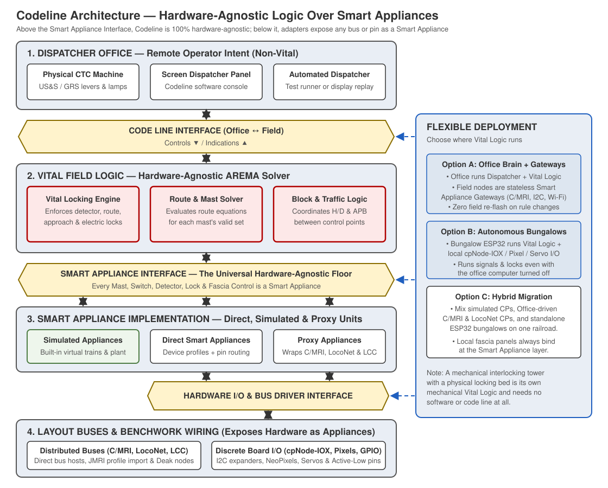
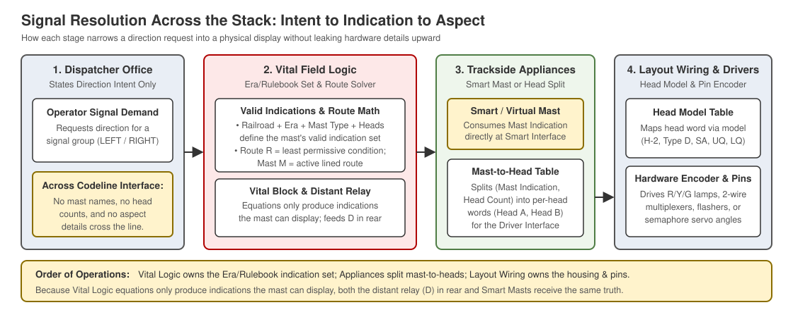

# Codeline: Prototypical Railroad Logic and Architecture

**Codeline** is the operational signaling and control runtime designed in [**Studio**](Studio.md) and backed by [**Smart Appliances**](SmartAppliances.md). Grounded in **AREMA Communications & Signals** practice and historical railroad rulebooks (see [**Background**](Background.md)), Codeline separates *how the railroad operates* from *how the benchwork is wired*.

---

## 1. A Subdivision Governed by Rules, Not Just Wires

On the prototype, traffic density determines where railroads invest in signaling and control. Codeline lets you combine multiple operating regimes across a single subdivision, each enforcing its own rulebook semantics:

- **Centralized Traffic Control — CTC (Standard Code Rule 261 / GCOR Chapter 10)**: Remote dispatcher control of power switches and absolute home signals from an office CTC machine across high-density junctions and single-track bottlenecks (such as CP Corporal to CP Logan).
- **Current of Traffic (Rule 251 / GCOR 9.14)**: Directional double track where trains move with the established current of traffic on each track and opposing intermediate signals are omitted (such as Luchessa to Corporal, with a CTC crossover island at Christopher).
- **Automatic Block & Automatic Permissive Block (ABS / APB)**: Single-track block signaling between control points. APB tumbles opposing signals to `STOP` head-block to head-block while allowing following trains to advance behind one another on permissive intermediate signals.
- **Yard Limits (Rule 93), Restricted Speed (Rule 105), and DTC / TWC**: Unsignaled or lower-density territory—yard mains, industrial leads, and branch lines governed by block authorities or track warrants.

### Engineering Principles

- **AREMA Vital Logic**: Interlocking, route, detector, approach, and time locking follow AREMA reference designs so unsafe dispatcher demands are rejected in the field rather than trusted at the office console.
- **Fail-Safe Restrictiveness & Positive Control**: Uncertainty always resolves toward the more restrictive state (`STOP`, occupied, out-of-correspondence). Code-line commands use **positive control** with explicit complementary terms—`829NWS (829RWS)` demands Switch `829` Normal, `(829NWS) 829RWS` demands Reverse, `(829NWS) (829RWS)` leaves the current alignment unchanged, and asserting both (`829NWS 829RWS`) is rejected as invalid. (See [**Background: Code-Line & Vital Relay Guide**](Background.md#4-uss-code-line-and-arema-vital-relay-guide).)
- **Executive-Owned Vital Fail-Safe Substitution**: Smart Appliances report honest physical state rather than encoding railroad-role fail-safe logic. Inside Codeline, unproven appliances initialize restrictively at startup, and whenever an appliance disconnects (MQTT LWT), enters maintenance (`/event OFFLINE`), or emits a vital fault (`/event FAULT`), Codeline substitutes the role-appropriate fail-safe state in vital logic:
  - Track-circuit `SENSOR` → `ACTIVE` (Occupied)
  - `TURNOUT` → `(NORMAL) (REVERSE)` (Out of correspondence; no route can clear over it)
  - `SIGNALMAST` → `STOP`
  - Electric switch lock `CONTROL` → `WLK` asserted (Unlocked; protecting signals held at `STOP`)
- **Modeler-Friendly Standalone Fallback**: On the prototype, a dead code line leaves field signals at `STOP` until crews obtain verbal authority. As an explicit modeler's option for solo running without a dispatcher, Codeline's field units can fall back to local trackside operation—unlocking electric locks and dual-control switches and running signals in standalone APB mode.

---

## 2. Three Layers, Two Clean Interfaces

Codeline separates the railroad into three layers connected by two crisp interfaces:

1. **The Dispatcher Office** — US&S CTC machine, software panel, local fascia plates, or automated test runner built on [`Appliance:CONTROL`](appliances/README.Appliances.md#appliancecontrol) and [`Appliance:LAMP`](appliances/README.Appliances.md#appliancelamp) operator surfaces.
   - Connected via the **Code Line Interface** *(US&S/AAR positive-control demands and office indications)* to
2. **The Vital Field Logic** — Hardware-agnostic AREMA locking, route evaluation, and block solver.
   - Sitting above the **Smart Appliance Interface** *(plain-English functional MQTT commands and physical feedback)* over
3. **Smart Appliances** — Simulated, Direct Microcontroller, or Proxy hardware endpoints (see [**Smart Appliances**](SmartAppliances.md)).

Above the **Smart Appliance Interface**, Codeline is 100% hardware-agnostic: the Dispatcher Office and Vital Field Logic never touch a pin number, an I²C address, a C/MRI bit offset, or an LED color.

---

## 3. The Code Line Interface vs. The Smart Appliance Interface

Keeping the two interfaces distinct preserves prototype fidelity at the office without leaking relay jargon into generic hardware:

- **Code Line Interface (Office ↔ Vital Field Logic)**: Carries non-vital, atomic office control packets (`827NWS (827RWS) 829NWS (829RWS) 828WGS 830WGS`) from free-moving CTC levers down to the field station, and verified office indications (`827NWK (827RWK) 828WGK 830WGK 830TEK`) back up to light panel jewels. The office console never knows how many masts stand at a control point, how many heads a mast carries, or how route equations are wired.
- **Smart Appliance Interface (Vital Field Logic ↔ Hardware)**: Translates solved vital outputs into plain, hardware-neutral commands (`NORMAL (REVERSE)` on `/turnout/829/cmd`, `APPROACH` on `/signalmast/830WAB/cmd`, `LAMP1 (LAMP2)` on `/control/Corporal/cmd`) and consumes closed-loop physical `/state` confirmations before advancing any vital sequence.

---

## 4. Vital Field Logic and Declarative Signal Resolution

When a control packet arrives across the Code Line Interface, the station's vital logic enforces a strict interlocking sequence before any signal clears:

1. **Detector, Route, and Approach/Time Locking**: Verify over-switch (`OS`) track circuits are vacant (`(ACTIVE)`), opposing signals are proven at `STOP` (`RGKR` up), and no approach- or time-locking timer (`TER`) is running. Unsafe demands are rejected with no field motion.
2. **Switch Alignment & Closed-Loop Correspondence**: Command unaligned turnouts (`TURNOUT`) and any independent dependent derail or mating crossover switch. While points are in transit (`(NORMAL) (REVERSE)`), panel switch lamps go dark and vital locking prevents any signal over those points from clearing until every switch in the route reports locked correspondence (`NORMAL (REVERSE)` or `(NORMAL) REVERSE`).
3. **Declarative Route & Signal Evaluation**: Rather than hand-coding boolean aspect equations per mast, the vital solver derives each mast's indication directly from its route topology:
   - Along each route originating at a mast, check every condition in series—switch positions and correspondence, `OS` and block occupancy, lever authority, and the next signal's indication—and take the **least permissive** result.
   - Across all routes from that mast, take the **most permissive** result. Because any unaligned or unproven route evaluates to `STOP`, at most one physically lined route can ever clear.
4. **Block `HOME` / `DISTANT` Circuits**: Each signal publishes `HOME` (block in rear vacant and directional stick/traffic clear) and `DISTANT` (governed mast at `APPROACH` or better) to the signal in rear so intermediate ABS/APB signals track trains automatically.
5. **Indication Return & Time Locking**: Vital logic trusts only physical `/state` confirmation—never its own `/cmd`. When a cleared signal is knocked down (`HS`) with an approaching train, Codeline waits until `/signalmast/{id}/state` confirms `STOP` before starting its vital Time Element Relay (`TER`) countdown and holding switch lock relays (`WLR`) until the timer expires.

See [**Walkthrough: Tracing a Move at CP Corporal**](Walkthrough.md#1-tracing-a-move-at-cp-corporal) for a complete step-by-step trace of this pipeline—including exact Code Line packets, Smart Appliance MQTT traffic, APB tumble-down, and signal cancellation.

---

## 5. Flexible Deployment Topologies

Because both interfaces are clean network boundaries, you choose **where** the Vital Field Logic executes—and can mix topologies on the same layout:

- **All-in-One in the Office**: Run both the Dispatcher Office and Vital Field Logic on the office computer, treating every microcontroller or `C/MRI`/`LocoNet`/`LCC` gateway under the layout as a stateless Smart Appliance. Updating routes or rulebooks never requires reflashing field hardware.
- **Distributed in the Bungalows**: Deploy each interlocking's Vital Field Logic onto an ESP32 under the layout alongside its local I/O appliance adapters, allowing signals, grade crossings, and local fascia locks to operate even when the office computer is off.
- **Hybrid Mix**: Run unfinished staging in simulation, existing benchwork on the office computer via Proxy Appliances, and new control points on standalone bungalow ESP32s simultaneously.
