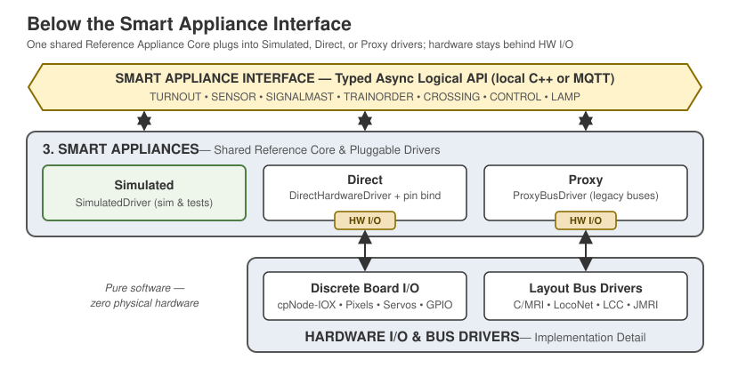
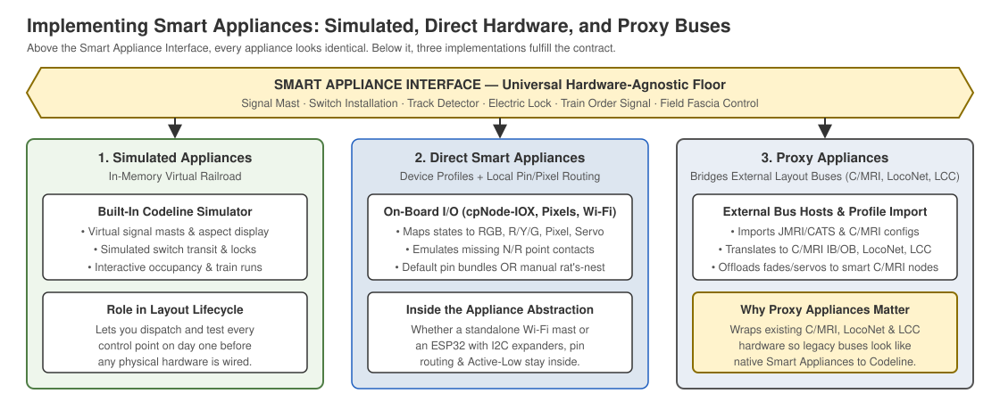

[](../README.md)
[Studio](Studio.md) · [Codeline](Codeline.md) · **▸ Smart Appliances**  
↳ [Appliances](appliances/README.Appliances.md) · [Clusters](clusters/README.Clusters.md) · [C++ Binding](bindings/Cpp.md) · [MQTT Binding](bindings/MQTT.md) · *uPython Binding*
---
---
# Smart Appliances: An Open Specification for Model Railroad Hardware

Most model railroad control systems treat layout hardware as loose collections of raw actuator and sensor bits: `Output 14` drives a Tortoise motor, `Inputs 3 and 4` read microswitches, `Input 11` reads a block detector, and `Outputs 22–27` drive six LEDs on a signal mast. Even over MQTT—such as a single-topic JMRI turnout using `CLOSED`/`THROWN`—a raw motor bit is not a railroad switch.

**Smart Appliances** is an open, **transport-agnostic** hardware specification modeled on **Zigbee / Matter capability clusters** and **AREMA functional interfaces**. It serves as the hardware layer beneath [**Codeline**](Codeline.md) and works with any layout control system, splitting cleanly into a **Typed Async Logical API** over mechanical **Transport & Language Bindings** over a shared **Reference Appliance Core + Driver Port**:

- [**Smart Appliance Capability Cluster Reference**](clusters/README.Clusters.md) — transport-agnostic library of 14 capability clusters (Canonical Type System, one-way async `COMMANDS`, cached + push `STATE`, typed `EVENTS`, `ATTRIBUTES`, `RESTART BEHAVIOR`, and the `FAULT <TYPE>` registry).
- [**Smart Appliance Catalog**](appliances/README.Appliances.md) — logical recipes for all 7 Smart Appliances (`Startup State`, command → state timelines, sub-components, and `OFFLINE` maintenance mode).
- [**C++ In-Process Binding, Reference Core & Test Harness**](bindings/Cpp.md) — zero-heap-churn embedded C++ interfaces, shared Reference Appliance Core + pluggable `HW I/O` Driver Port, optional MQTT Mirror glue, and deterministic functional testing.
- [**MQTT Transport & Text Wire Encoding Binding**](bindings/MQTT.md) — mechanical two-plane/four-topic projection, `TOKEN`/`(TOKEN)` positive-control wire encoding, sole retained `/state`, dynamic broadcast discovery, and broker LWT mapping.

---

## 1. Why a Smart Appliance Is More Than an "MQTT Motor"

Under **AREMA** signaling practice, vital logic interacts with wayside equipment through closed-loop **functional interfaces**—commanding an operation and requiring positive physical correspondence before the next step proceeds:

- **Raw turnout motor vs. Smart Switch (`TURNOUT`)**: A 1-topic MQTT turnout echoes its own command (`THROWN`) immediately, fooling control software into believing points are locked before the motor finishes moving. A Smart Switch accepts positive-control commands (`NORMAL` / `REVERSE` — encoded on MQTT as `NORMAL (REVERSE)` / `(NORMAL) REVERSE`) and reports honest physical correspondence: `NORMAL` when locked Normal, `REVERSE` when locked Reverse, and `IN_TRANSIT` (`(NORMAL) (REVERSE)`) while points are moving or out of correspondence (with `FAULT SHORTED_CONTACTS`, `FAULT STALL`, or `FAULT OVERCURRENT` on hardware failure). Crossovers (`815`/`815A`) and switch-plus-derail pairs (`827`/`827D`) remain independent endpoints coordinated by the controller above the interface.
- **Raw LEDs vs. Smart Signal Mast (`SIGNALMAST`)**: A Smart Signal Mast accepts a functional indication (`STOP`, `RESTRICTING`, `APPROACH`, `DIVERGING_CLEAR`, `CLEAR`) plus optional orthogonal approach lighting (`lit: bool`), translates it to physical heads under its provisioned `mast.rulebook` (`SPTCO-1960` flashing red vs. `SP-1990` lunar, `GCOR-1995`, etc.) and hardware binding, and reports back the indication physically displayed.

---

## 2. The Typed Async Logical API (Clusters & Appliances)

Every Smart Appliance is a transport-agnostic logical endpoint composed from reusable **Capability Clusters** following a uniform, non-blocking asynchronous interaction model (see [**Cluster Reference**](clusters/README.Clusters.md)):

- **Typed One-Way `COMMANDS`** *(Controller → Appliance)*: Fire-and-forget intent (`setAlignment`, `setIndication`, `setLamps`, `offline`, `online`, `setAttribute`, `exportConfig`)—zero synchronous RPC blocking so local in-process callers and networked MQTT callers behave identically.
- **Observable Physical `STATE`** *(Appliance → Controller)*: Exposed both as a non-blocking cached getter (`state()`) for deterministic interlocking ticks and as a push notification (`onStateChanged`) for observers and transport adapters.
- **Discrete `EVENTS`** *(Appliance → Controller)*: Non-retained edge notifications (`FaultEvent`, `OfflineEvent`/`OnlineEvent`, `UnavailableEvent`, `ButtonEvent`, `AttributesEvent`, `ConfigEvent`).
- **Unified `ATTRIBUTES` & Cooperative `tick(now_ms)`**: Every root (`position.speed`) and sub-component (`head.A.position.current`, `head.A.color.palette.YELLOW`, `head.A.RED.onoff.on`) attribute is managed through [`Cluster:MAINTENANCE`](clusters/README.Clusters.md#clustermaintenance) under three access classes (`RO`, `RW`, `VITAL`). Exiting `OFFLINE` via `online()` triggers an in-place **logical restart** so updated `NV config` takes effect from a deterministic startup state.

Core architectural rules:

- **Pure Hub-and-Spoke Endpoints**: Appliances store zero peer bindings in flash—the supervisory controller owns layout topology, locking, routing, and vital fail-safe substitution (on `OfflineEvent`, `FaultEvent`, or `UnavailableEvent`). Only [`Cluster:APB`](clusters/README.Clusters.md#clusterapb) opts into peer-to-peer `endpoint_ref` links for standalone computerless APB/MSS installations.
- **No Fake Capabilities & Strict Orthogonality**: A fixed-resistor GPIO LED exposes `ON/OFF` without `DIMMING` or `COLOR`; a Tortoise stall motor exposes `TURNOUT` without `POSITION`. Approach-lighting toggles preserve saved `DIMMING` and `COLOR`; operational turnout commands always use `TurnoutCommand`, never `POSITION` percentages.
- **Implementation Details Stay Below the Seam**: Contact debouncing, Active-Low polarity, and wiring multiplexers (`3MUX2A`) reside inside hardware or driver ports below the Smart Appliance API.
- **1:1 Machine-Readable Schema**: Every cluster's types, commands, states, events, attributes, persistence, and defaults map directly to a single future YAML/JSON schema driving validators, Studio UIs, language bindings (e.g., C++ or MicroPython), MQTT codecs, and generated documentation.

### 2.1 Capability Clusters → [Full Cluster Reference](clusters/README.Clusters.md)

| Family | Clusters | Role |
| :--- | :--- | :--- |
| **Universal & Addressing** | [`MAINTENANCE`](clusters/README.Clusters.md#clustermaintenance), [`GROUPS`](clusters/README.Clusters.md#clustergroups) | `OFFLINE`/`ONLINE` gate & logical restart, `identify`, `export`/`import`, `set`/`clear`, `cycle`, `POST`, `FaultType` registry, and decentralized multicast groups |
| **Lighting & Actuation** | [`ON/OFF`](clusters/README.Clusters.md#clusteronoff), [`DIMMING`](clusters/README.Clusters.md#clusterdimming), [`COLOR`](clusters/README.Clusters.md#clustercolor), [`POSITION`](clusters/README.Clusters.md#clusterposition) | Orthogonal binary `on`, gamma-corrected intensity/fade, AREMA & 16-bit RGB/HSB color palette, and normalized `0.00%`–`100.00%` servo/stepper positioning |
| **Detection & Human Input** | [`HOLDOFF`](clusters/README.Clusters.md#clusterholdoff), [`LEVER`](clusters/README.Clusters.md#clusterlever), [`BUTTON`](clusters/README.Clusters.md#clusterbutton) | Local optical gap-bridging, hardware-neutral `BitVector` switch/lever frames, and momentary pushbuttons |
| **Railroad Domain** | [`TURNOUT`](clusters/README.Clusters.md#clusterturnout), [`SENSOR`](clusters/README.Clusters.md#clustersensor), [`MAST`](clusters/README.Clusters.md#clustermast), [`APB`](clusters/README.Clusters.md#clusterapb), [`CROSSING`](clusters/README.Clusters.md#clustercrossing) | Closed-loop switch correspondence, binary detection, rulebook signal display & approach lighting, optional MSS/APB tumble-down, and crossing protection |

### 2.2 Appliance Catalog → [Full Appliance Catalog](appliances/README.Appliances.md)

| Family | Appliance & Role | Composed Clusters | Operational Summary |
| :--- | :--- | :--- | :--- |
| **Wayside Plant** | **[`TURNOUT`](appliances/README.Appliances.md#applianceturnout)** — `turnout` | `MAINTENANCE` (`post=false`), `TURNOUT`, opt. `POSITION`, `GROUPS` | `NORMAL` / `REVERSE` commands; `IN_TRANSIT` while moving |
| **Wayside Plant** | **[`SENSOR`](appliances/README.Appliances.md#appliancesensor)** — `sensor` | `MAINTENANCE`, `SENSOR`, `HOLDOFF` *(optical/IR)*, opt. `GROUPS` | Read-only track/contact detector: `active: bool` |
| **Wayside Plant** | **[`SIGNALMAST`](appliances/README.Appliances.md#appliancesignalmast)** — `signalmast` | `MAINTENANCE`, `MAST`, per-head clusters, opt. `APB`, `GROUPS` | `(SignalIndication, lit)` under `rulebook`; `STOP` while moving/faulted |
| **Wayside Plant** | **[`TRAINORDER`](appliances/README.Appliances.md#appliancetrainorder)** — `trainorder` | `MAINTENANCE`, 1-head `MAST`, `head.A`, opt. `GROUPS` | One directional face (`STOP`/`APPROACH`/`CLEAR`); dual board = 2 appliances |
| **Wayside Plant** | **[`CROSSING`](appliances/README.Appliances.md#appliancecrossing)** — `crossing` | `MAINTENANCE`, `CROSSING`, `flasher`, opt. `bell`, `gate.W`/`E`, `GROUPS` | `setActive(bool)` → `{ flashing, gates_down }` |
| **Operator Surface** | **[`CONTROL`](appliances/README.Appliances.md#appliancecontrol)** — `control` | `MAINTENANCE`, `LEVER`, opt. `BUTTON`, `lamp.*`, `GROUPS` | Atomic `BitVector` lamp/switch frames + `ButtonEvent` for fascia plates, locks, yard selectors, and CTC columns |
| **Auxiliary / Light** | **[`LAMP`](appliances/README.Appliances.md#appliancelamp)** — `lamp` | `MAINTENANCE`, `ON/OFF`, opt. `DIMMING`, `COLOR`, `GROUPS` | `setOn(bool)` — Maintainer Call, depot/structure lights, and RGB/dimmable room lighting |

---

## 3. Mechanical Transport & Language Bindings

Just like the [**Code Line Interface**](Codeline.md#3-the-code-line-interface-vs-the-smart-appliance-interface), Smart Appliances separate the **logical contract** from its **language binding, transport, and wire encoding**. Co-located hardware—such as a field bungalow reading local `cpNode-IOX` I²C cards or a physical CTC machine reading its own lever/lamp boards—never needs to pay for an external MQTT broker round-trip just to talk to itself.

```text
  = Top Logical Interface (Vital Logic / CTC Office / Test Runner) =
  [  Glue / Binding                                                ]
  [  MQTT PUBLISH    (optional)                                    ]
  [  MQTT SUBSCRIBE  (optional)                                    ]
  [  Glue / Binding                                                ]
  = Bottom Logical Appliance (Reference Core + Driver Port)        =
```

Two normative bindings are specified today—leaving the logical API open to additional in-process runtimes such as **MicroPython** that interoperate seamlessly over the same MQTT wire protocol:

1. **In-Process Embedded C++ Binding** → [**`bindings/Cpp.md`**](bindings/Cpp.md)
   - Zero-heap-churn, no-exceptions embedded C++ interfaces (`ITurnout`, `ISensor`, `IMast`, `IControl`, ...), fixed-width `BitVector` and `Percent100` types, direct `endpoint_ref` pointers, and cooperative `tick(now_ms)` driving rollover-safe `ElapsedMillis` timers.
   - Supports **Local-Only** execution (zero broker dependency, immune to Wi-Fi outages) and **Local + MQTT Mirror** (vital `cmd`/`state` runs directly in RAM while an optional mirror adapter publishes `/state` and `/event` and subscribes to `/maint` so Studio keeps live discovery, mimic display, and `OFFLINE` calibration).
2. **MQTT Transport & Text Wire Encoding Binding** → [**`bindings/MQTT.md`**](bindings/MQTT.md)
   - Maps operational and management surfaces onto a minimal static topic footprint (`/cmd` unretained, `/state` sole retained topic, `/maint` point-to-point unretained, `/event` unretained, curated multicast `{channel}/all` unretained, plus retained `/apb`) with plain-English `TOKEN`/`(TOKEN)` positive-control payloads.
   - Eliminates classic distributed-hardware hazards: atomic positive-control frames prevent split-topic races, unretained `/cmd` + `maintenance.post = false` prevent power-up switch throws, a closed curated `[GROUP <slug>] <COMMAND>` grammar on `{channel}/all` prevents broadcast `OFFLINE`/attribute-overwrite chaos, unretained `EXPORT CONFIG` with `0–250 ms` jitter + boot `/event CONFIG` prevent zombie retained config, and broker LWT surfaces `UnavailableEvent`.

See [**Walkthrough**](Walkthrough.md) for concrete MQTT wire traces of routing, offline servo calibration, and dynamic discovery.

---

## 4. Reference Appliance Core & Three Pluggable Drivers



Above the Smart Appliance Interface, every appliance speaks the exact same Typed Async Logical API. Below it, a shared **Reference Appliance Core** pattern (`TurnoutCore`, `SensorCore`, `MastCore`, ...—specified in [**`bindings/Cpp.md`**](bindings/Cpp.md) and repeatable in other target runtimes such as MicroPython) implements all cluster state machines, `MAINTENANCE` gating, `HOLDOFF` timers, `POSITION` ramps, and `MAST` rulebooks once per runtime—delegating only minimal physical hooks across a narrow **Driver Port** (`ITurnoutDriver`, `ISensorDriver`, `IMastDriver`, ...) to **three interchangeable backends**:



### 1. Simulated Appliances (`SimulatedDriver` — Virtual Railroad & Functional Test Fixture)
Plugging an in-memory **`SimulatedDriver`** into the Reference Appliance Core yields the built-in virtual railroad—stepping turnouts through `IN_TRANSIT` timers, rendering signal aspects on screen, and injecting virtual train shunts before any hardware is wired. The same `SimulatedDriver` doubles as the **reference boilerplate stub** for new hardware drivers and as a **deterministic fault-injection test harness** (running the entire functional test suite in microseconds via `tick(now_ms)` over both direct C++ and MQTT loopback; see [**C++ Binding: Functional Test Framework**](bindings/Cpp.md#5-deterministic-functional-test-framework--transport-parity)).

### 2. Direct Smart Appliances (`DirectHardwareDriver` — Embedded MCU + Pin Binding)
An ESP32, Raspberry Pi Pico W, or bungalow controller driving local `cpNode-IOX` (`MCP23017`), `PCA9685` servo/PWM boards, NeoPixels, Tortoise motors, and microswitches binds the Reference Core directly to local I/O:

- **Signal Masts across Hardware Types**: Provision one `mast.rulebook` (`SP-1990`, `SPTCO-1960`, `GCOR-1995`) and bind heads to RGB H-2 searchlights (`Cluster:COLOR`), 3- or 4-lamp discrete heads (`Cluster:ON/OFF`), 2-wire `3MUX2A` multiplexed decoders, NeoPixel chains, or servo semaphores (`Cluster:POSITION`). The operational API remains identical across all of them.
- **Flexible Switch Feedback Regimes**: Under [`Cluster:TURNOUT`](clusters/README.Clusters.md#clusterturnout), `turnout.feedback_regime` supports `TWO_CONTACT` (Normal + Reverse microswitches), `ONE_CONTACT` (Normal switch + emulated Reverse), or `SIMULATED` (timed transit emulation when no point contacts are installed).

See [**Studio: Hardware Bindings and Benchwork Wiring Documentation**](Studio.md#4-hardware-bindings-and-legacy-layout-import) for pin bundles, active-low defaults, cardstock board templates, and cable loom drawings.

### 3. Proxy Appliances (Wrapping External `C/MRI`, `LocoNet`, `LCC`, and JMRI Buses)
Binding the Reference Core to a **`ProxyBusDriver`** presents the standard Smart Appliance API upward while bridging low-level bits, packets, or events across existing `C/MRI`, `LocoNet`, `LCC`, or legacy MQTT buses downward:

- **Upgrading 1-Bit Turnouts**: Wrapping a 1-bit C/MRI or MQTT turnout output with `turnout.feedback_regime = SIMULATED` gives it realistic `IN_TRANSIT` correspondence and full `OFFLINE` maintenance behavior.
- **Bit-Mapped vs. Smart Bus Nodes**: Against a classic C/MRI SMINI, the Proxy Appliance runs hardware binding and 1 Hz flashing in `OB[]` on the host; against smart Wi-Fi C/MRI nodes (such as Andrew Deak's nodes), the Proxy flips target bits in `OB[]` while the remote node executes incandescent fade ramps and servo profiles locally.
