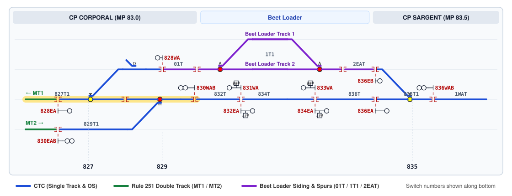

[](../README.md)
[Studio](Studio.md) · **[Codeline](Codeline.md)** · [Smart Appliances](SmartAppliances.md)  
↳ **▸ Walkthrough**
---
---
# Studio, Codeline, and Smart Appliances in Action

These three worked examples trace concrete operating and maintenance scenarios across [**Studio**](Studio.md), [**Codeline**](Codeline.md), and [**Smart Appliances**](SmartAppliances.md)—showing the [**MQTT Wire Binding**](bindings/MQTT.md) on the wire. When Vital Field Logic and local I²C appliances are co-located on a bungalow or CTC machine, the identical logical commands, states, and events execute directly in memory via the [**C++ Binding**](bindings/Cpp.md) (with optional MQTT mirroring for Studio).

---

## 1. Tracing a Move at CP Corporal



A westbound freight from Watsonville has cleared **CP Sargent** (`SIGNALMAST` `836WAB`) onto the single-track mainline toward **CP Corporal**, where single track expands into directional double track (`MT1` Westbound and `MT2` Eastbound) over **Switch 829**. Clearing `836WAB` established westbound traffic locking across the single track, lining intermediate permissive signals **`833WA`** (block `834T`) and **`831WA`** (block `832T`) ahead of the train, with `831WA` displaying `APPROACH` toward Corporal's westbound two-head US&S H-2 searchlight home signal, **Mast `830WAB`** (currently at `STOP`).

### Why CP Corporal Has Two Switch-and-Signal Groups

CP Corporal is split into two interlocking sections—**Switch 829 / Signal 830** (`829T1`) on the east and **Switch 827 / Signal 828** (`827T1`) on the west (paired with dependent derail **`827D`** on the Beet Loader siding):

- Splitting the plant enables **simultaneous parallel moves**: an eastbound train on `MT2` can run `830EAB → Switch 829 Reverse` onto the single track while a local switcher exits the Beet Loader siding over `828WA → Switch 827 Reverse` heading west onto `MT1`.
- For our through westbound freight continuing straight onto `MT1` (`Switch 829 Normal → Switch 827 Normal`), the route traverses **both** `829T1` and `827T1`. Because there is no intermediate home mast between `829` and `827` on the main track, clearing **Mast `830WAB`** onto `MT1` requires **both** `Switch 829 Normal + Signal 830 Left` and `Switch 827 Normal + Signal 828 Left`.

### Step-by-Step Wire Trace

At the CTC console (`CONTROL`), the dispatcher verifies **Switch Lever 827** is `NORMAL`, sets **Switch Lever 829** to `NORMAL`, turns **Signal Levers 830 and 828** to `LEFT` (westbound), and presses **CODE**. Notice that the CTC machine sends only the station control frame—it knows nothing about mast counts, head layouts, or LED colors:

```text
Dispatcher Office             Codeline (Vital Logic)              Smart Appliances (at Corporal)
─────────────────             ──────────────────────              ──────────────────────────────
1. Press CODE button
   codelines/.../controls ──▶ "827NWS (827RWS)
                               829NWS (829RWS)
                               828WGS 830WGS"

                              2. Checks OS occupancy & locks:
                                 /sensor/829T1/state == "(ACTIVE)"
                                 /sensor/827T1/state == "(ACTIVE)"
                                 /signalmast/830EAB/state == "STOP"
                                 /signalmast/828EA/state  == "STOP"
                                 -> 829WLR & 827WLR pick

                              3. Commands switches & independent derail:
                                 /turnout/829/cmd  ──────────────▶ "NORMAL (REVERSE)"
                                 /turnout/827/cmd  ──────────────▶ "NORMAL (REVERSE)"
                                 /turnout/827D/cmd ──────────────▶ "NORMAL (REVERSE)"

                              4. Points unlock & begin moving:
                                 /turnout/829/state ◀──────────── "(NORMAL) (REVERSE)" (In Transit)
   codelines/.../indications ◀── "(829NWK) (829RWK)"
   (Panel N & R lamps go dark)

                              5. Points lock in correspondence:
                                 /turnout/829/state  ◀──────────── "NORMAL (REVERSE)"
                                 /turnout/827/state  ◀──────────── "NORMAL (REVERSE)"
                                 /turnout/827D/state ◀──────────── "NORMAL (REVERSE)"
                                 -> Vital Logic ANDs 827 + 827D -> 827NWKR picks

                              6. Route solves to APPROACH (next signal at Christopher is STOP):
                                 /signalmast/830WAB/cmd ─────────▶ "APPROACH"

                              7. Mast lights Yellow/Red (per rulebook) & confirms:
                                 /signalmast/830WAB/state ◀─────── "APPROACH"
                                 (Vital Logic sees state != STOP -> RGKR down, HR up)
   codelines/.../indications ◀── "827NWK (827RWK)
                                  829NWK (829RWK)
                                  828WGK 830WGK"
   (Panel switch & signal lamps light)
```

### APB Tumble-Down & Signal Cancellation

- **Independent Switch & Derail Correspondence**: Because `827D` is its own [`Appliance:TURNOUT`](appliances/README.Appliances.md#applianceturnout) endpoint, Codeline commands `827` and `827D` separately and ANDs both `/state` confirmations (`NORMAL (REVERSE)`) before `827NWKR` picks.
- **Approach Upgrade (`831WA`) While the Train Is in `834T`**: With `832T` vacant (`(ACTIVE)`) and opposing signals `830EAB`/`828EA` at `STOP`, Corporal publishes `/signalmast/830WAB/apb` → **`HOME DISTANT`** (`DISTANT` asserts because `830WAB/state` is `APPROACH`). Permissive mast **`831WA`** (composing [`Cluster:APB`](clusters/README.Clusters.md#clusterapb)) sees `HOME DISTANT` plus `832T == (ACTIVE)` and upgrades from `APPROACH` to **`CLEAR`**.
- **Train Enters `832T` (Rear Protection & Directional Stick)**: When the freight passes `831WA`, `/sensor/832T/state` publishes **`ACTIVE`**. `831WA` immediately drops to `STOP`, sets its directional stick (`apb.stick = true`), and—once `834T` behind the caboose clears—publishes `HOME (DISTANT)` on `/signalmast/831WA/apb` so a following westbound train can advance to `833WA` on `APPROACH`.
- **Dispatcher Cancels `830WAB` (`HS`) Before Arrival**: If the dispatcher centers Signal Lever `830` and presses `CODE`, the office sends `(830WGS) (830EGS) 830HS` and Codeline sends `/signalmast/830WAB/cmd` ← `"STOP"`. Codeline waits until `/signalmast/830WAB/state` physically confirms `"STOP"` (`RGKR` picks) before starting its vital **Time Element Relay (`TER`)** countdown and transmitting `(830WGK) 830TEK` to the office—keeping `829WLR` locked until the timer expires.

---

## 2. Offline Servo Calibration

When a maintainer replaces a servo linkage on `turnout/829`, end-stop percentages must be tuned on live hardware without allowing routes to clear across uncalibrated points:

1. **Enter Maintenance Mode (`OFFLINE`)**:
   - Maintainer sends `OFFLINE` to `{channel}/turnout/829/maint`.
   - [`Cluster:MAINTENANCE`](clusters/README.Clusters.md#clustermaintenance) sets `maintenance.offline = true`, emits `/event OFFLINE`, and unlocks `VITAL` writes. Codeline sees `/event OFFLINE`, substitutes `(NORMAL) (REVERSE)` in vital logic (holding protecting signals at `STOP`), and withholds operational `/cmd` to `829`. Meanwhile, `turnout/829` keeps `/cmd` and physical `/state` live for bench testing.
2. **Nudge `position.current` Incrementally**:
   - Maintainer moves near the Normal stop (`SET position.current=18.00`), observes the point rail, and nudges (`SET position.current += 1.50`, then `SET position.current -= 0.50`) until the point seats firmly without servo buzz.
   - [`Cluster:POSITION`](clusters/README.Clusters.md#clusterposition) drives the servo directly and emits `/event ATTRIBUTES` reporting `position.current = 19.00`, while `/state` reports `NORMAL (REVERSE)` as soon as the Normal microswitch closes—without altering `position.presets`.
3. **Commit Explicit Presets & Verify Throw**:
   - Maintainer writes the observed percentages explicitly to NV flash (`SET position.presets.NORMAL=19.00`, then repeats for `SET position.presets.REVERSE=81.25`), triggering `/event CONFIG`.
   - Maintainer tests a full closed-loop throw with `/cmd (NORMAL) REVERSE` and verifies `(NORMAL) REVERSE` on `/state` (or runs `CYCLE 5 1500` for mechanical break-in).
4. **Return to Service (`ONLINE`)**:
   - Maintainer sends `ONLINE` to `{channel}/turnout/829/maint`.
   - `ONLINE` triggers the appliance's **logical restart** ([`RESTART BEHAVIOR`](clusters/README.Clusters.md#restart-behavior-power-on-and-exiting-offline)): `turnout/829` cancels any active `CYCLE`, reloads `NV config`, resets `maintenance.offline = false`, reads its physical point contacts without energizing the motor, and publishes `/state`, `/event CONFIG`, and `/event ONLINE` last. Codeline re-admits `turnout/829` using its initialized physical `/state`.

*(The same workflow calibrates a semaphore mast such as `signalmast/831WA` via sub-component paths: `SET head.A.position.current += 2.00` and `SET head.A.position.presets.CLEAR=72.50` while `OFFLINE`.)*

---

## 3. Dynamic Studio Discovery

When [**Studio**](Studio.md) connects to a layout channel—or when a maintainer replaces a microcontroller under the benchwork—it builds an exact live inventory without retained `/config` zombies:

1. **Subscribe to Unretained Events**: Studio subscribes to `{channel}/+/+/event`. Because Smart Appliances never publish retained `/config` topics, unplugged or renamed boards leave no stale metadata on the broker.
2. **Broadcast `EXPORT CONFIG` with Jitter**: Studio publishes `EXPORT CONFIG` to `{channel}/all`. Every live appliance waits a random `0–250 ms` delay and replies with `{channel}/{type}/{id}/event` `CONFIG <data>`. Studio parses each reply to learn every appliance's composed clusters, sub-components, NV settings, and `groups.members` lists.
3. **Hot-Plug Arrival**: Powering on a replacement ESP32 hosting `signalmast/831WA` automatically emits a single boot-time `/event CONFIG <data>`, adding the node to Studio's live inventory without re-polling. If a board later drops offline, broker LWT notifies controllers to apply fail-safe substitution, and the next `EXPORT CONFIG` sweep reflects only live hardware.
